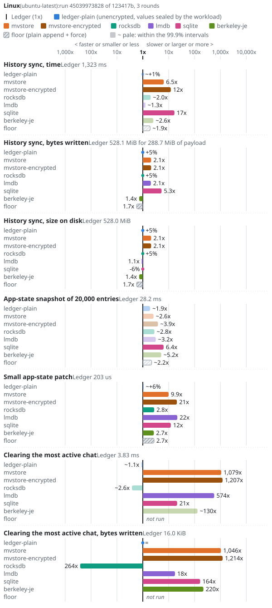
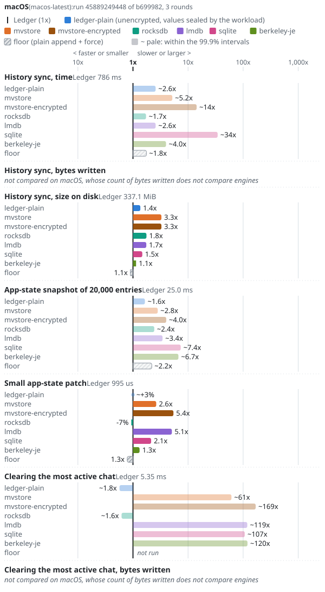
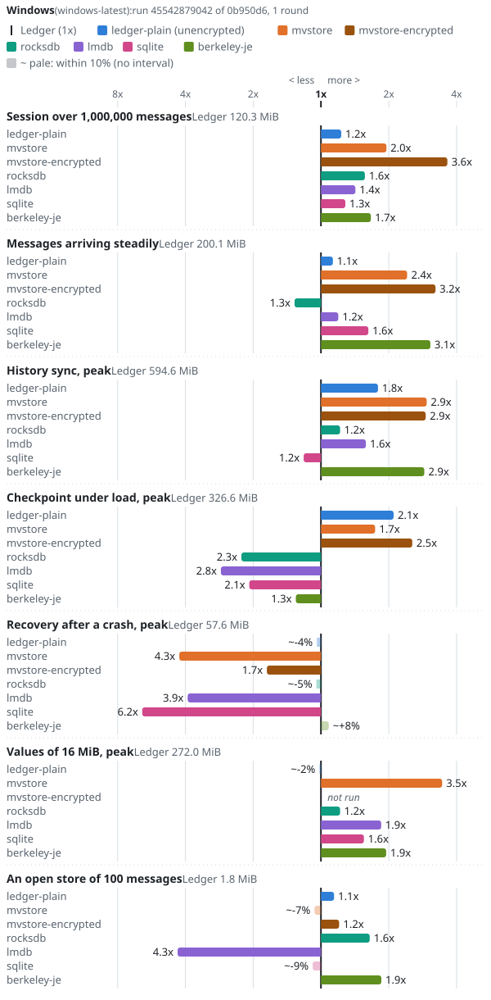
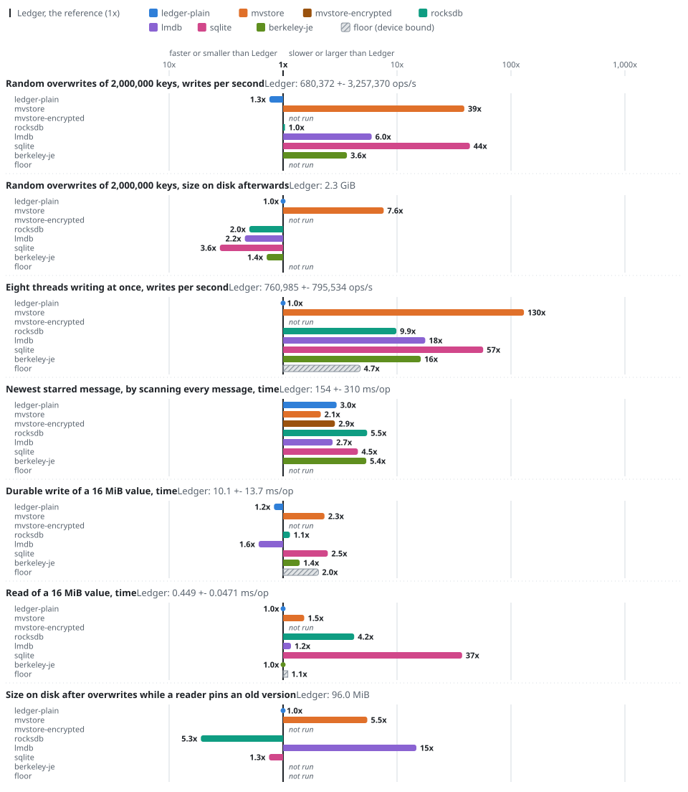
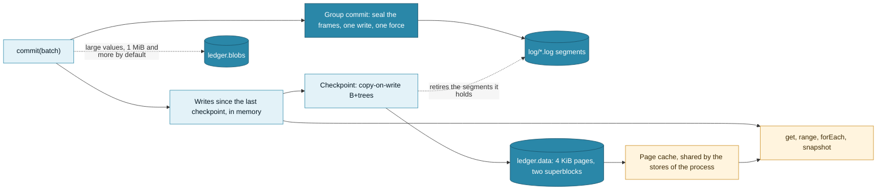

<div align="center">


<br/>

[](https://github.com/Auties00/Ledger/actions/workflows/ci.yml)
[](https://openjdk.org/projects/jdk/26/)
[](LICENSE)
[](#ledger)

</div>

# Ledger

Ledger is an embedded storage engine for Java applications with one writing process that need their data durable,
encrypted and ordered. It is pure Java, with no dependency.

- **Two durability levels:** a commit is atomic and visible when it returns, durable once awaited.
- **Key spaces** ordered by their encoded keys, each resident in memory or paged through a shared cache.
- **Atomic batches**, and transactions that read and write alone.
- **Snapshots** fixed while commits go on, exact counts, and range removals whose cost does not grow with their size.
- **Encryption:** AES-256-GCM under a 256-bit key or a passphrase, or plaintext under checksums.
- **A memory backend** with the same contract, for temporary data and tests.
- **Stop and recovery:** a failed write or force stops the store and the next open recovers every durable commit; a
  test kit simulates the crashes in between.

> [!IMPORTANT]
> Ledger has no release yet, and its API may still change. It requires **Java 26**: its commits park a thread with a
> timeout and then without one, which could leave a virtual thread parked for good on the first builds of Java 25.

**Contents:** [Install](#install) | [Quick start](#quick-start) | [Guide](#guide) | [Performance](#performance) |
[Design](#design) | [Building](#building)

## Install

Until the first release, build Ledger from source (`mvn install -DskipTests` in a clone of this repository), then
depend on it, and on `ledger-testkit` at test scope to test what your own code survives:

```xml
<dependency>
    <groupId>com.github.auties00</groupId>
    <artifactId>ledger</artifactId>
    <version>0.1.0-SNAPSHOT</version>
</dependency>
```

<details>
<summary><b>Module and JVM flags</b></summary>

The module is `com.github.auties00.ledger`, and its whole API is the package of the same name.
`--enable-native-access=com.github.auties00.ledger` (`ALL-UNNAMED` on the class path) lets a store on Windows write its
log through to stable storage in one round trip, on a device that reports it can, instead of a write and a force.
`jdk.management` is optional: without it a store cannot tell which collector the JVM runs, and never packs the values
of its fastest commits into arrays that collector would not copy.

</details>

## Quick start

Open a store in a directory you own, write two entries in one atomic batch, wait until they are on stable storage and
read one back:

```java
var settings = Keyspace.resident("settings", KeyCodec.utf8(), ValueCodec.utf8());
var messages = Keyspace.paged("messages", KeyCodec.int64(), ValueCodec.utf8());
try (var ledger = Ledger.builder()
        .directory(directory)
        .encryption(Encryption.passphrase("correct horse battery staple".toCharArray()))
        .keyspace(settings)
        .keyspace(messages)
        .build()) {
    var commit = ledger.commit(ledger.newBatch()
            .put(messages, 1L, "Hello")
            .put(settings, "theme", "dark"));
    commit.awaitDurable(); // on stable storage from here on
    System.out.println(ledger.get(messages, 1L).orElseThrow()); // Hello
}
```

## Guide

Every example is run by [`ReadmeExamplesTest`](core/src/test/java/com/github/auties00/ledger/ReadmeExamplesTest.java),
which also checks that this page shows it verbatim.

### Open a store

`Ledger.builder()` is staged: where the data lives, how its files are encrypted, then the key spaces and options. A
store creates the key spaces it does not have yet and keeps the ones it was not opened with untouched.

```java
var ledger = Ledger.builder()
        .directory(directory)                   // created if missing; one process holds it at a time
        .encryption(Encryption.key(masterKey))  // 32 bytes; Encryption.none() for plaintext files
        .keyspace(notes)
        .pageCache(64L << 20)                   // the cache of paged key spaces, on the heap
        .checkpointEvery(128L << 20)            // log growth between checkpoints
        .onBackgroundFailure(failure -> System.err.println("Checkpoint failed: " + failure))
        .build();
```

`Ledger.Options` gives every option's default, most of them sized from the maximum heap. Any thread may call any
method, virtual threads included.

### Define key spaces

A key space names a set of entries and the codecs of their keys and values. Entries are ordered by the unsigned bytes
their keys encode to: the built-in `int64()` and `int32()` flip the sign bit of a big-endian number, and a composite
key lays its fields one after the other.

```java
record MessageKey(long chat, long sequence) {
    static final ValueLayout.OfLong BIG_ENDIAN = ValueLayout.JAVA_LONG_UNALIGNED.withOrder(ByteOrder.BIG_ENDIAN);

    // Big-endian with the sign bit flipped, so the bytes sort as the numbers do: by chat, then by sequence
    static final KeyCodec<MessageKey> CODEC = KeyCodec.of(
            key -> 16,
            (key, target) -> {
                target.set(BIG_ENDIAN, 0, key.chat() ^ Long.MIN_VALUE);
                target.set(BIG_ENDIAN, 8, key.sequence() ^ Long.MIN_VALUE);
            },
            source -> new MessageKey(
                    source.get(BIG_ENDIAN, 0) ^ Long.MIN_VALUE,
                    source.get(BIG_ENDIAN, 8) ^ Long.MIN_VALUE));

    static KeyRange<MessageKey> chat(long chat) {
        return KeyRange.between(new MessageKey(chat, Long.MIN_VALUE), new MessageKey(chat + 1, Long.MIN_VALUE));
    }
}

// Small and read often: every entry held in memory, decoded
static final Keyspace<String, String> CHATS = Keyspace.resident("chats", KeyCodec.utf8(), ValueCodec.utf8());
// Larger than memory should hold: read through the page cache
static final Keyspace<MessageKey, String> MESSAGES = Keyspace.paged("messages", MessageKey.CODEC, ValueCodec.utf8());
```

<details>
<summary><b>Resident or paged, codecs and limits</b></summary>

- **Resident** key spaces hold every entry in memory, decoded: a read costs no I/O and returns the instance the store
  holds, so their values should be immutable. **Paged** ones read through the page cache and decode on each read.
- Codecs encode in place through `MemorySegment`s. `of` hands the decoder a copy it may keep; `ofTrusted` hands it the
  store's own memory, valid only during the call.
- Keys encode to 1 to 1,024 bytes and values to at most 1 GiB. Names are 1 to 64 lowercase letters, digits, `_`, `-`
  or `.`.

</details>

### Read and write

A batch applies all of its writes or none, and readers never see part of it. Any number of threads may commit at once:
a batch waits only for earlier batches that write its keys.

```java
ledger.commit(ledger.newBatch()
        .put(CHATS, "family", "Family")
        .put(MESSAGES, new MessageKey(7, 1), "Hi")
        .put(MESSAGES, new MessageKey(7, 2), "Dinner at eight?")
        .put(MESSAGES, new MessageKey(7, 3), "Yes"));
ledger.commit(ledger.newBatch().delete(MESSAGES, new MessageKey(7, 1)));

Optional<String> chat = ledger.get(CHATS, "family");                          // Optional[Family]
List<Entry<MessageKey, String>> page = ledger.range(MESSAGES, MessageKey.chat(7).reversed(), 50);
Optional<Entry<MessageKey, String>> newest = ledger.first(MESSAGES, MessageKey.chat(7).reversed());
long count = ledger.size(MESSAGES);                                           // 2, exact
```

### Read, then write, in a transaction

A transaction runs alone against the latest state, so what it reads cannot change before its writes apply; they apply
together when it returns, and not at all if it throws. Other commits wait meanwhile, so blind writes belong in a batch.

```java
ledger.update(transaction -> {
    var unread = transaction.get(counters, "unread").map(Integer::parseInt).orElse(0);
    transaction.put(counters, "unread", Integer.toString(unread + 1));
    transaction.put(counters, "last-sender", "Ada");
});
```

### Choose the durability

Concurrent commits share the forces that make them durable.

```java
// Deferred: atomic and visible when commit returns; a crash before it is durable can lose it
var commit = ledger.commit(ledger.newBatch().put(MESSAGES, new MessageKey(7, 4), "Received"));

// Durable: wait before acting on it, for example before acknowledging the message to its sender
commit.awaitDurable();
boolean durable = commit.isDurable();                     // true
boolean inTime = commit.awaitDurable(Duration.ofMillis(5)); // a bounded wait

// Or wait for every commit made so far at once
ledger.awaitDurable();
```

On macOS a force also empties the drive's cache (`F_FULLFSYNC`), so durable means durable against a power cut there too.

### Take snapshots, scan and remove ranges

A snapshot reads one state, unchanged by later commits, until it is closed.

```java
try (var snapshot = ledger.snapshot()) {
    // Clear a chat: the cost does not grow with the number of entries removed
    ledger.commit(ledger.newBatch().deleteRange(MESSAGES, MessageKey.chat(7)));

    // The snapshot still reads the state before the removal
    long visited = snapshot.forEach(MESSAGES, MessageKey.chat(7), (key, text) -> {
        System.out.println(key.sequence() + ": " + text);
        return true; // false stops the scan
    });
    System.out.println(visited + " " + snapshot.size(MESSAGES) + " " + ledger.size(MESSAGES)); // 3 3 0
}
```

Close a snapshot once its reads are done: it keeps the pages of its state from being reused, so under steady writes
the files grow while it stays open.

### Encrypt with a key or a passphrase

Every log frame, page and header is sealed with AES-256-GCM under a key per file derived from the master key, which is
never written to disk. A store reopens only with the encryption and the secret it was created with.

```java
var withKey = Encryption.key(masterKey());                       // a 256-bit key the application keeps
var withPassphrase = Encryption.passphrase(passphrase());        // PBKDF2-HMAC-SHA256, 600,000 iterations
```

<details>
<summary><b>What encryption covers</b></summary>

A passphrase costs about half a second at each open. The associated data binds each sealed unit to its file, its
position and the generation that wrote it, so a unit that was moved, replayed from an older file or altered fails to
open, and no nonce repeats under a key, even across a checkpoint a crash cut short. `Encryption.none()` keeps the files
in plaintext, each frame and page under a CRC-32C. The files still reveal their size, and how it grows.

</details>

### Keep a store in memory

A store in memory keeps the contract of one on disk without writing anything: every commit is durable at once, and the
data is gone when it closes.

```java
try (var ledger = Ledger.builder().memory().keyspace(notes).build()) {
    ledger.commit(ledger.newBatch().put(notes, "draft", "Remember the milk")).awaitDurable(); // returns at once
}
```

### Handle failures

Every failure is an unchecked `LedgerException`; misuse, such as a closed store, throws `IllegalStateException` or
`IllegalArgumentException` instead.

- `LedgerIoException`: a read, write or force failed. A failed write or force **stops** the store; a failed checkpoint
  the store started on its own does not: it goes to `onBackgroundFailure` and is retried.
- `LedgerCorruptedException`: data failed authentication or its checksum beyond what recovery repairs.
- `LedgerKeyException`: the store was opened with another encryption or secret than it was created with; a wrong secret
  is never reported as damage.
- `LedgerLockedException`: another store, in this process or another, holds the directory.

### Testing what your code survives

The test kit's `CrashFileSystem` keeps what a force made durable apart from what was written since. Stop the simulated
process at a chosen write or force, take a state a power cut or a crash could leave, and open the store again on it.

```java
var disk = CrashFileSystem.create();
var notes = Keyspace.paged("notes", KeyCodec.utf8(), ValueCodec.utf8());
var ledger = Ledger.builder()
        .directory(disk.getPath("/store"))
        .encryption(Encryption.none())
        .keyspace(notes)
        .build();
ledger.commit(ledger.newBatch().put(notes, "a", "durable")).awaitDurable();

disk.stopAtForce(0); // the next force fails, and the simulated process stops there
var commit = ledger.commit(ledger.newBatch().put(notes, "b", "visible"));
try {
    commit.awaitDurable();
} catch (LedgerIoException stopped) {
    // The store has stopped: every later commit and wait throws this too, reads keep working
}

// What a power cut at that moment could leave; the same seed draws the same state
var afterCut = disk.afterPowerLoss(new Random(42));
try (var recovered = Ledger.builder()
        .directory(afterCut.getPath("/store"))
        .encryption(Encryption.none())
        .keyspace(notes)
        .build()) {
    System.out.println(recovered.get(notes, "a")); // Optional[durable]
    System.out.println(recovered.get(notes, "b")); // Optional[visible] or Optional.empty, never half a batch
}
```

<details>
<summary><b>What the crash model assumes</b></summary>

The model journals metadata in order and caches file data, as ext4, XFS, APFS and NTFS do, and assumes no more than
POSIX promises: a write not yet forced may be kept, dropped, or kept in some of its 512-byte sectors only
(`createNtfs()` journals its namespace as NTFS does). It simulates files, directories, positional and gathering
channels, file locks and atomic renames, not memory mapping. Ledger's own crash tests run on it.

</details>

## Performance

The [benchmark](benchmark/README.md) compares Ledger with H2 MVStore, RocksDB, LMDB, SQLite and Berkeley DB Java
Edition, each with the same contract, 256 MiB cache and durability, on workloads modelled on what
[Cobalt](https://github.com/Auties00/Cobalt) asks of its store and on workloads Ledger is not built for. The numbers
come from the [Benchmark workflow](.github/workflows/benchmark.yml) on GitHub's hosted runners, whose hardware is
shared and whose disks are virtual: compare engines within a chart, not with your own device.

- `ledger`, the 1x of every chart, is Ledger encrypted: it seals and authenticates its own files.
- `ledger-plain` is Ledger unencrypted. In the Cobalt workloads it and every other engine store values the workload
  sealed with AES-GCM itself.
- `floor` is a plain file appended and forced per batch, with its index in memory. It is not an engine, and not a
  bound either: Ledger beats it in most durable workloads.

> [!NOTE]
> A bar is an engine's cost divided by Ledger's, on a logarithmic axis: right of the 1x line it is slower or takes
> more, left of it faster or takes less, by the factor its label gives. A pale bar with a `~` is one the run does not
> settle: a time within the two results' 99.9% confidence intervals, or a memory result, which has no interval, within
> 10%. A row's title gives Ledger's result. Click a chart to open it on its own, then hover a bar for the engine's
> result, or read every result in [`benchmarks.tsv`](tools/readme/benchmarks.tsv); [Reading the
> numbers](benchmark/README.md#reading-the-numbers) has the methodology and its caveats.

<!-- bench:begin -->
<!-- Generated by tools/readme/charts.py from tools/readme/benchmarks.tsv and tools/readme/charts.tsv; do not edit by hand. -->

### Durable commits

Writes on stable storage when the call returns: a session stored before a message is sent, a received message before it is acknowledged.

<picture><source media="(prefers-color-scheme: dark)" srcset=".github/assets/bench-commit-ubuntu-dark.svg"></picture>
<details><summary>Windows and macOS</summary>
<picture><source media="(prefers-color-scheme: dark)" srcset=".github/assets/bench-commit-windows-dark.svg"></picture>
<picture><source media="(prefers-color-scheme: dark)" srcset=".github/assets/bench-commit-macos-dark.svg"></picture>
</details>

### Bulk writes

A history sync of 200,000 messages, an app-state snapshot applied atomically, and clearing the most active chat.

<picture><source media="(prefers-color-scheme: dark)" srcset=".github/assets/bench-ingest-ubuntu-dark.svg"></picture>
<details><summary>Windows and macOS</summary>
<picture><source media="(prefers-color-scheme: dark)" srcset=".github/assets/bench-ingest-windows-dark.svg"></picture>
<picture><source media="(prefers-color-scheme: dark)" srcset=".github/assets/bench-ingest-macos-dark.svg"></picture>
</details>

### Reads

Pages of a chat, lookups by id and reopening a store, over a history of 200,000 messages. Every engine but `ledger`, `ledger-plain` included, also decrypts each value the workload sealed.

<picture><source media="(prefers-color-scheme: dark)" srcset=".github/assets/bench-read-ubuntu-dark.svg"></picture>
<details><summary>Windows and macOS</summary>
<picture><source media="(prefers-color-scheme: dark)" srcset=".github/assets/bench-read-windows-dark.svg"></picture>
<picture><source media="(prefers-color-scheme: dark)" srcset=".github/assets/bench-read-macos-dark.svg"></picture>
</details>

### Memory

The resident memory the store and the operation added to the process (Java heap, native memory and mapped pages alike): at the end, or at its peak.

<picture><source media="(prefers-color-scheme: dark)" srcset=".github/assets/bench-memory-ubuntu-dark.svg"></picture>
<details><summary>Windows and macOS</summary>
<picture><source media="(prefers-color-scheme: dark)" srcset=".github/assets/bench-memory-windows-dark.svg"></picture>
<picture><source media="(prefers-color-scheme: dark)" srcset=".github/assets/bench-memory-macos-dark.svg"></picture>
</details>

### Workloads Ledger is not built for

Random overwrites of a data set larger than the cache, a question no key space indexes, 16 MiB values, and a reader that pins an old version.

<picture><source media="(prefers-color-scheme: dark)" srcset=".github/assets/bench-limits-ubuntu-dark.svg"></picture>
<details><summary>Windows and macOS</summary>
<picture><source media="(prefers-color-scheme: dark)" srcset=".github/assets/bench-limits-windows-dark.svg"></picture>
<picture><source media="(prefers-color-scheme: dark)" srcset=".github/assets/bench-limits-macos-dark.svg"></picture>
</details>

<!-- bench:end -->

## Design



A commit is visible once it is applied in memory and journaled to the log, in 16 MiB segments each sealed under a key
of its own. A checkpoint later folds the writes since the last one into the copy-on-write trees of the data file, and
only then are the log segments it holds retired. A read takes each key space's tree under the writes still in memory,
so it never waits for a writer. Values of at least `Options.largeValues` (1 MiB by default) are written once, to
`ledger.blobs`, rather than to the log and again to a checkpoint.

<details>
<summary><b>How a commit becomes durable</b></summary>

Commits apply without a lock, each once the earlier commits on its keys have applied, and are published in sequence
order; transactions and batches with a range removal run alone. One flush at a time seals every queued log frame,
writes them with one call and forces the segment once, then wakes every commit that waited for them; after a force
that woke several, it waits up to three quarters of a force and one millisecond so that concurrent committers share
the next one, while a lone committer is never held back. On Linux (`O_DIRECT` and `O_DSYNC`), and on Windows with
native access on a device that reports forced unit access or a disabled or non-volatile write cache, the log is
written through to stable storage and the force skipped; `-Dledger.log.writeThrough=off` forces every write.

</details>

<details>
<summary><b>Checkpoints, memory and recovery</b></summary>

A checkpoint applies the writes since the last one to the trees copy on write while commits go on, forces the file,
then writes and forces the superblock the last checkpoint did not use, so a crash at any point leaves the last durable
state whole. Until then those writes stay in memory: a commit waits for the running checkpoint once the log holds more
than six checkpoint intervals the files do not, or more than two while those writes hold more than half the maximum
heap, and a store idle for 30 to 60 seconds checkpoints once they hold a megabyte. The page cache is on the heap,
shared by the stores of the process, and evicts with CLOCK.

An open reads the newer superblock that authenticates and replays the log after it: it recovers every durable commit,
never part of a batch, and repairs a log whose tail a crash tore. Damage anywhere else throws
`LedgerCorruptedException` rather than return it.

</details>

<details>
<summary><b>What Ledger does not do</b></summary>

- One process writes a store at a time, where SQLite and LMDB let several (`MultiProcessWritersBenchmark`).
- There is no query language and no secondary index: keep your own index as a key space, written in the same batch.
  A question no key space orders by is a scan, which an index SQLite builds on the spot answers far faster.
- Values below `Options.largeValues` reach the device twice, in the log and again in a checkpoint.
- Keys are at most 1,024 bytes, values at most 1 GiB, and a transaction's writes at most a little under 2 GiB of log.

</details>

## Building

`mvn verify` runs the engine's tests, its crash tests on the test kit's file system among them, and builds the
benchmark; [benchmark/README.md](benchmark/README.md) explains how to run it. Ledger is released under the
[MIT License](LICENSE).
