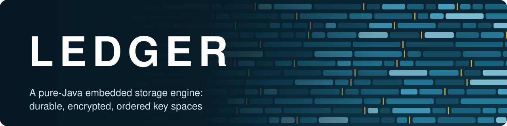
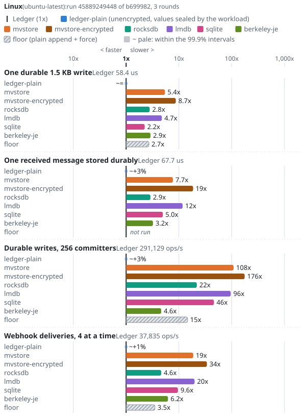
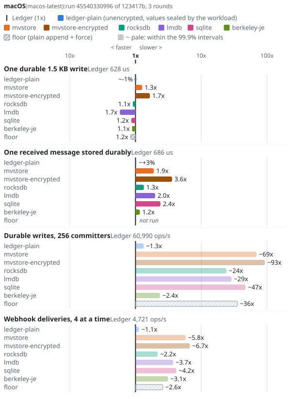
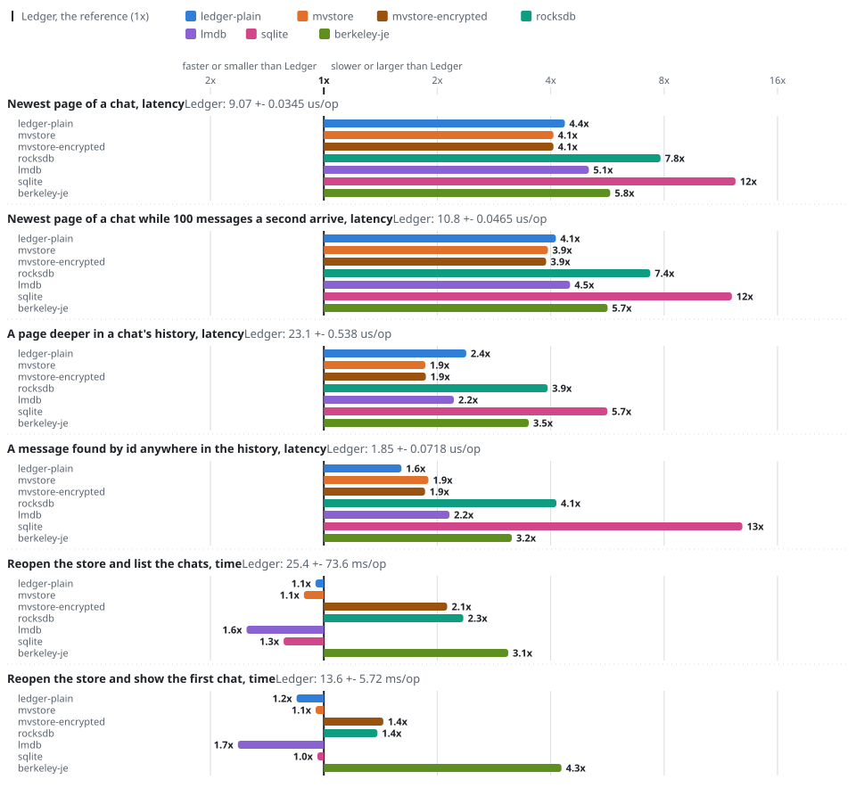
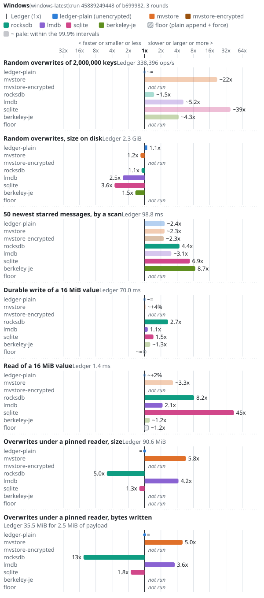
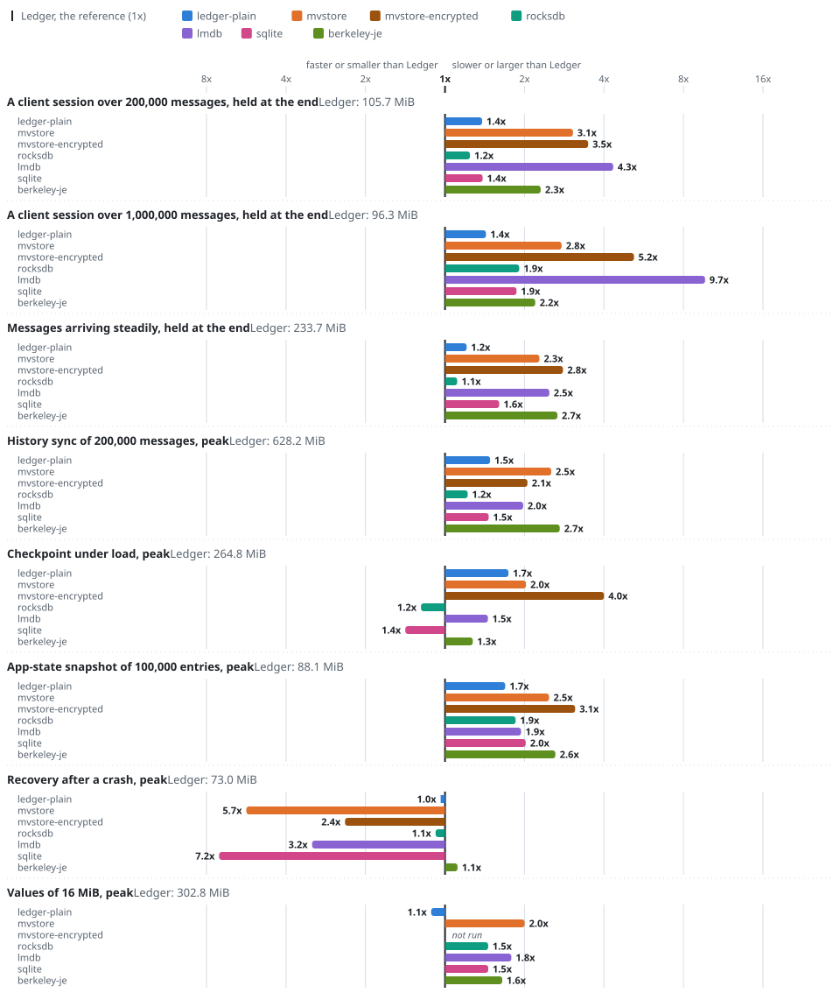
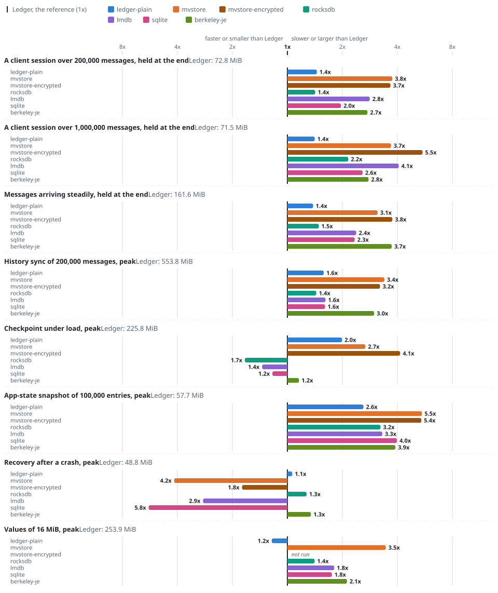
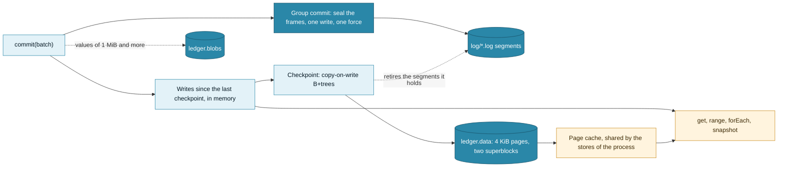

<div align="center">



<br/>

[](https://github.com/Auties00/Ledger/actions/workflows/ci.yml)
[](https://openjdk.org/projects/jdk/26/)
[](LICENSE)
[](#ledger)

</div>

# Ledger

Ledger is an embedded storage engine for Java applications with one writing process that need their data durable,
encrypted and ordered. Every commit goes to a group-committed log of AES-256-GCM frames, which checkpoints fold into
copy-on-write B+trees; values of 1 MiB and more (by default) are written once, to a file of their own. Data lives in
named key spaces ordered by their encoded keys, each either resident in memory or paged from disk through a shared
cache, and changes in atomic batches or in transactions that read and write alone. Reads see one state: the latest, or a
snapshot that stays fixed while commits go on. Range removals cost the same however many entries they take, counts are
exact, and a commit is visible when it returns and durable once awaited. Files are sealed under a 256-bit key or a
passphrase, or kept in plaintext with checksums; a memory backend keeps the same contract without a disk. A write or
force that fails stops the store, and the next open recovers every durable commit. It is pure Java, with no dependency.

> [!IMPORTANT]
> Ledger has no release yet, and its API may still change. It requires **Java 26**: its commits park a thread with a
> timeout and then without one, which could leave a virtual thread parked for good on the first builds of Java 25.

**Contents:** [Install](#install) | [Quick start](#quick-start) | [Guide](#guide) | [Performance](#performance) |
[Design](#design) | [Building](#building) | [License](#license)

## Install

Until the first release, build Ledger from source and install it in your local Maven repository:

```shell
git clone https://github.com/Auties00/Ledger.git
cd Ledger
mvn install -DskipTests
```

Then depend on the engine, and on the test kit if you want to test what your own code survives (see
[Testing what your code survives](#testing-what-your-code-survives)):

```xml
<dependency>
    <groupId>com.github.auties00</groupId>
    <artifactId>ledger</artifactId>
    <version>0.1.0-SNAPSHOT</version>
</dependency>
<dependency>
    <groupId>com.github.auties00</groupId>
    <artifactId>ledger-testkit</artifactId>
    <version>0.1.0-SNAPSHOT</version>
    <scope>test</scope>
</dependency>
```

The module is `com.github.auties00.ledger`, and its whole API is the package of the same name.

- `--enable-native-access=com.github.auties00.ledger` (`ALL-UNNAMED` on the class path) lets a store on Windows write
  its log through to stable storage in one round trip, on a device that reports it can, instead of a write and a force.
- `jdk.management` is optional; the class path resolves it by default. Without it a store cannot tell which collector
  the JVM runs, and never packs the values of its fastest commits into arrays that collector would not copy.

## Quick start

Open a store in a directory you own (`directory` is a `Path`), write two entries in one atomic batch, wait until they
are on stable storage and read one back:

```java
var settings = Keyspace.resident("settings", KeyCodec.utf8(), ValueCodec.utf8());
var messages = Keyspace.paged("messages", KeyCodec.int64(), ValueCodec.utf8());
try (var ledger = Ledger.builder()
        .directory(directory)
        .encryption(Encryption.passphrase("correct horse battery staple".toCharArray()))
        .keyspace(settings)
        .keyspace(messages)
        .build()) {
    var commit = ledger.commit(ledger.newBatch()
            .put(messages, 1L, "Hello")
            .put(settings, "theme", "dark"));
    commit.awaitDurable(); // on stable storage from here on
    System.out.println(ledger.get(messages, 1L).orElseThrow()); // Hello
}
```

## Guide

One focused example per task. Every example on this page is a test,
[`ReadmeExamplesTest`](core/src/test/java/com/github/auties00/ledger/ReadmeExamplesTest.java), which also checks
that this page prints each one as it runs.

### Open a store

`Ledger.builder()` is staged: where the data lives, then how its files are encrypted, then the key spaces and
options.

```java
var ledger = Ledger.builder()
        .directory(directory)                   // created if missing; one process holds it at a time
        .encryption(Encryption.key(masterKey))  // 32 bytes; Encryption.none() for plaintext files
        .keyspace(notes)
        .pageCache(64L << 20)                   // the cache of paged key spaces, on the heap
        .checkpointEvery(128L << 20)            // log growth between checkpoints
        .onBackgroundFailure(failure -> System.err.println("Checkpoint failed: " + failure))
        .build();
```

A store keeps the key spaces it was not opened with untouched, and creates the ones it does not have yet. Every
option has a default sized from the heap: the page cache takes a sixteenth of the maximum heap, between 1 MiB and
64 MiB, shared by every store of the process; a checkpoint runs every sixteenth of the maximum heap of log, between
64 MiB and 512 MiB.

> [!TIP]
> Any thread may call any method, virtual threads included. A call that waits (for durability, or behind an earlier
> commit on the same keys) spins briefly, then parks without holding a carrier.

### Define key spaces

A key space names a set of entries and the codecs of their keys and values. Entries are ordered by the unsigned bytes
their keys encode to, so a key codec decides the order: the built-in `int64()` and `int32()` flip the sign bit of a
big-endian number, and a composite key lays its fields one after the other.

```java
record MessageKey(long chat, long sequence) {
    static final ValueLayout.OfLong BIG_ENDIAN = ValueLayout.JAVA_LONG_UNALIGNED.withOrder(ByteOrder.BIG_ENDIAN);

    // Big-endian with the sign bit flipped, so the bytes sort as the numbers do: by chat, then by sequence
    static final KeyCodec<MessageKey> CODEC = KeyCodec.of(
            key -> 16,
            (key, target) -> {
                target.set(BIG_ENDIAN, 0, key.chat() ^ Long.MIN_VALUE);
                target.set(BIG_ENDIAN, 8, key.sequence() ^ Long.MIN_VALUE);
            },
            source -> new MessageKey(
                    source.get(BIG_ENDIAN, 0) ^ Long.MIN_VALUE,
                    source.get(BIG_ENDIAN, 8) ^ Long.MIN_VALUE));

    static KeyRange<MessageKey> chat(long chat) {
        return KeyRange.between(new MessageKey(chat, Long.MIN_VALUE), new MessageKey(chat + 1, Long.MIN_VALUE));
    }
}

// Small and read often: every entry held in memory, decoded
static final Keyspace<String, String> CHATS = Keyspace.resident("chats", KeyCodec.utf8(), ValueCodec.utf8());
// Larger than memory should hold: read through the page cache
static final Keyspace<MessageKey, String> MESSAGES = Keyspace.paged("messages", MessageKey.CODEC, ValueCodec.utf8());
```

- **Resident** key spaces hold every entry in memory, decoded: a read costs no I/O and no decoding, and returns the
  instance the store holds, so their values should be immutable. Their entries are read into memory on the store's own
  threads from the key space's first use, or while the store opens with `loadResidentAtOpen(true)`.
- **Paged** key spaces read their entries through the page cache and decode them on each read.
- Codecs encode in place, into memory the store provides, through `MemorySegment`s. `of` hands the decoder a copy it
  may keep; `ofTrusted` hands it the store's own memory, valid only during the call, and saves the copy.
- Keys encode to 1 to 1,024 bytes and values to at most 1 GiB. Names are 1 to 64 lowercase letters, digits, `_`, `-`
  or `.`.

### Read and write

```java
ledger.commit(ledger.newBatch()
        .put(CHATS, "family", "Family")
        .put(MESSAGES, new MessageKey(7, 1), "Hi")
        .put(MESSAGES, new MessageKey(7, 2), "Dinner at eight?")
        .put(MESSAGES, new MessageKey(7, 3), "Yes"));
ledger.commit(ledger.newBatch().delete(MESSAGES, new MessageKey(7, 1)));

Optional<String> chat = ledger.get(CHATS, "family");                          // Optional[Family]
List<Entry<MessageKey, String>> page = ledger.range(MESSAGES, MessageKey.chat(7).reversed(), 50);
Optional<Entry<MessageKey, String>> newest = ledger.first(MESSAGES, MessageKey.chat(7).reversed());
long count = ledger.size(MESSAGES);                                           // 2, exact
```

A batch applies all of its writes or none, in the order they were added, and readers never see part of it. It
encodes keys and values as they are added, on the calling thread, so the work is done before the batch waits for the
writer; it may be reused once `commit` returns. Any number of threads may commit at once: batches on different keys
apply at the same time, and a batch waits only for earlier batches that write its keys.

### Read, then write, in a transaction

A transaction runs alone against the latest state, so a value it reads cannot change before its writes apply. Its
writes apply together when it returns, and not at all if it throws.

```java
ledger.update(transaction -> {
    var unread = transaction.get(counters, "unread").map(Integer::parseInt).orElse(0);
    transaction.put(counters, "unread", Integer.toString(unread + 1));
    transaction.put(counters, "last-sender", "Ada");
});
```

> [!CAUTION]
> Other commits wait while a transaction runs, so keep it to reading and writing. Blind writes are cheaper through a
> batch, which encodes its values before it waits.

### Choose the durability

A commit has two levels of durability. When `commit` returns the batch is atomic, visible to every later read, and
survives a crash of the process; it survives a loss of power once it is durable.

```java
// Deferred: atomic and visible when commit returns; survives a crash of the process, not a loss of power
var commit = ledger.commit(ledger.newBatch().put(MESSAGES, new MessageKey(7, 4), "Received"));

// Durable: wait before acting on it, for example before acknowledging the message to its sender
commit.awaitDurable();
boolean durable = commit.isDurable();                     // true
boolean inTime = commit.awaitDurable(Duration.ofMillis(5)); // a bounded wait

// Or wait for every commit made so far at once
ledger.awaitDurable();
```

Waiting is optional: a commit nobody waits for becomes durable with the commits that follow. Concurrent commits share
the forces that make them durable, so a thousand threads waiting cost the device about as much as one. On macOS a
force also empties the drive's cache (`F_FULLFSYNC`), so durable means durable against a power cut there too.

### Take snapshots, scan and remove ranges

```java
try (var snapshot = ledger.snapshot()) {
    // Clear a chat: the cost does not grow with the number of entries removed
    ledger.commit(ledger.newBatch().deleteRange(MESSAGES, MessageKey.chat(7)));

    // The snapshot still reads the state before the removal
    long visited = snapshot.forEach(MESSAGES, MessageKey.chat(7), (key, text) -> {
        System.out.println(key.sequence() + ": " + text);
        return true; // false stops the scan
    });
    System.out.println(visited + " " + snapshot.size(MESSAGES) + " " + ledger.size(MESSAGES)); // 3 6 3
}
```

- A snapshot reads one state, unchanged by later commits, from any thread, until it is closed. It keeps the pages of
  that state from being reused, so under steady writes the files grow while one stays open: close it when its reads
  are done.
- `forEach` reads one state for the whole scan too, so use it for more entries than a list should hold;
  `readEncoded` and `forEachEncoded` hand over the encoded bytes without decoding them.
- `deleteRange` records the range and drops its pages when a checkpoint next writes them. Its entries are counted
  after the commit, on a thread of the store's own.

### Encrypt with a key or a passphrase

```java
var withKey = Encryption.key(masterKey());                       // a 256-bit key the application keeps
var withPassphrase = Encryption.passphrase(passphrase());        // PBKDF2-HMAC-SHA256, 600,000 iterations
```

An encrypting store seals every log frame, page and header with AES-256-GCM, under one key per file derived from the
master key with HKDF-SHA256. The associated data binds each sealed unit to its file, its position and the generation
that wrote it, so a unit that was moved, replayed from an older file or altered fails to open. The master key is never
written to disk; a passphrase costs about half a second each time the store opens. `Encryption.none()` keeps the files
in plaintext, each frame and page still under a CRC-32C. A store reopens only with the encryption it was created
with, and tells a wrong secret from damage:

```java
try (var ledger = Ledger.builder()
        .directory(directory)
        .encryption(Encryption.passphrase("not the passphrase".toCharArray()))
        .keyspace(notes)
        .build()) {
    ledger.get(notes, "a");
} catch (LedgerKeyException wrongKey) {
    System.err.println(wrongKey.getMessage()); // a wrong secret, never reported as damage
}
```

> [!NOTE]
> What the files still reveal is their size, and how it grows.

### Keep a store in memory

```java
try (var ledger = Ledger.builder().memory().keyspace(notes).build()) {
    ledger.commit(ledger.newBatch().put(notes, "draft", "Remember the milk")).awaitDurable(); // returns at once
}
```

A store in memory keeps the contract of one on disk (batches, transactions, snapshots, counts) without writing
anything: every commit is durable at once, and the data is gone when it closes. Use it for temporary sessions and for
tests.

### Handle failures

Every failure is an unchecked `LedgerException`; misuse, such as a closed store or a key space the store was not
opened with, throws `IllegalStateException` or `IllegalArgumentException` instead.

- `LedgerIoException`: a read, write or force failed. After a failed write or force the store cannot tell which
  commits reached stable storage, so it **stops**: every later commit and every wait for durability throws again,
  while reads keep working. Close it and open it again to recover every durable commit.
- `LedgerCorruptedException`: data failed authentication or its checksum beyond what recovery repairs (a log whose
  tail a crash tore is repaired), thrown by the read that meets it, or by the open when every open reads it.
- `LedgerKeyException`: the store was opened with another encryption than the one it was created with.
- `LedgerLockedException`: another store, in this process or another, holds the directory. One process, and one
  store in it, writes a directory at a time:

```java
try (var second = Ledger.builder().directory(directory).encryption(Encryption.none()).keyspace(notes).build()) {
    second.size(notes);
} catch (LedgerLockedException locked) {
    System.err.println(locked.directory() + " is open in another store");
}
```

A checkpoint the store started on its own that fails does not stop it, since the log still holds every commit: it is
reported to `onBackgroundFailure`, and the next checkpoint retries.

### Testing what your code survives

The test kit's `CrashFileSystem` is a file system in memory that keeps what a force made durable apart from what was
written since. Run a store on it, stop the simulated process at a chosen write or force, then take the state a loss of
power (`afterPowerLoss`) or a crash of the process (`afterProcessCrash`) could leave, and open the store again on it.
Ledger's own crash tests run on it; so can yours, or another store's.

```java
var disk = CrashFileSystem.create();
var notes = Keyspace.paged("notes", KeyCodec.utf8(), ValueCodec.utf8());
var ledger = Ledger.builder().directory(disk.getPath("/store")).encryption(Encryption.none()).keyspace(notes).build();
ledger.commit(ledger.newBatch().put(notes, "a", "durable")).awaitDurable();

disk.stopAtForce(0); // the next force fails, and the simulated process stops there
var commit = ledger.commit(ledger.newBatch().put(notes, "b", "visible"));
try {
    commit.awaitDurable();
} catch (LedgerIoException stopped) {
    // The store has stopped: every later commit and wait throws this too, reads keep working
}

// What a power cut at that moment could leave; the same seed draws the same state
var afterCut = disk.afterPowerLoss(new Random(42));
try (var recovered = Ledger.builder().directory(afterCut.getPath("/store")).encryption(Encryption.none()).keyspace(notes).build()) {
    System.out.println(recovered.get(notes, "a")); // Optional[durable]: every durable commit is back
    System.out.println(recovered.get(notes, "b")); // never durable: a power cut may keep the batch or drop it, never half of it
}
```

The model journals metadata in order and caches file data, as ext4, XFS, APFS and NTFS do, and assumes no more than
POSIX promises: a write not yet forced may be kept, dropped, or kept in some of its 512-byte sectors only.
`CrashFileSystem.createNtfs()` keeps its namespace as NTFS journals it. It simulates what an embedded store uses
(files, directories, positional and gathering channels, file locks, atomic renames of files) and nothing else, memory
mapping included.

## Performance

The [benchmark](benchmark/README.md) compares Ledger with H2 MVStore, RocksDB, LMDB, SQLite and Berkeley DB Java
Edition on JMH workloads modelled on what [Cobalt](https://github.com/Auties00/Cobalt) asks of its store, and on
workloads Ledger is not built for. Every engine gets the same contract (byte-ordered key spaces, atomic batches,
ordered scans, range removals, read views), the same 256 MiB cache and the same two durability levels. The Cobalt
workloads seal every value with AES-GCM before it reaches an engine that cannot encrypt, as Cobalt does; `ledger`
encrypts its files itself and is not sealed again, while `ledger-plain` (Ledger without encryption) is sealed like the
others. The `floor` is not an engine: it appends every batch to one file and forces it, keeps its whole index in
memory and never reads back, recovers or compacts, so it shows what the device charges for writing and forcing the same
bytes. Ledger can still cost less than the floor where it does less work for those bytes: it seals a whole log frame
at once where the floor's values are sealed one by one, and where the device allows it (on Linux, and on Windows with
native access) it writes its log through to stable storage in one round trip where the floor takes a write and a
force.

The numbers come from the [Benchmark workflow](.github/workflows/benchmark.yml) on GitHub's hosted runners. Each run
measures every engine of a workload in turn, three rounds of it, and keeps each result's median round, so a runner that
slows down during the job weighs on every engine alike. Hosted runners share their hardware and their disks are
virtual: compare engines within one run, as the charts do, rather than one run with another, and expect absolute
numbers on your own device to differ. On macOS every engine's durable write empties the drive's cache, and the bytes
written are those that reached the disk rather than those passed to write calls; [Reading the
numbers](benchmark/README.md#reading-the-numbers) has the other caveats.

> [!NOTE]
> A bar shows an engine's cost divided by Ledger's (encrypted, the reference line at 1x): its time per operation, the
> inverse of its throughput, or the bytes or memory it took. It runs **right** when the engine is slower or takes more
> than Ledger and **left** when it is faster or takes less, whatever the unit, on a logarithmic axis. Each chart's text
> list has the absolute numbers, with the half-width of JMH's 99.9% confidence interval over the round's measurement
> iterations, which is wide for the workloads that measure only a few. The numbers live in
> [`tools/readme/benchmarks.tsv`](tools/readme/benchmarks.tsv), which names the run, commit and runner behind every one,
> and [`tools/readme/charts.tsv`](tools/readme/charts.tsv) picks what the charts show. To measure again, run the
> Benchmark workflow (`gh workflow run benchmark.yml -f os=all -f group=all -f rounds=3`), then
> ([tools/readme/README.md](tools/readme/README.md)):
>
> ```shell
> python tools/readme/fetch.py <run id>...
> python tools/readme/charts.py
> ```

<!-- bench:begin -->
<!-- Generated by tools/readme/charts.py from tools/readme/benchmarks.tsv and tools/readme/charts.tsv; do not edit by hand. -->

### Durable commits

Writes that are on stable storage when the call returns: a session stored before a message is sent, a received message stored before it is acknowledged, a webhook delivery stored before it is answered.

Where another engine costs less than Ledger in these runs:

- macOS, one durable 1.5 KB write, latency: lmdb (1.7x faster), sqlite (1.2x faster), berkeley-je (1.1x faster), rocksdb (1.1x faster)

**Linux** (ubuntu-latest; run [45039971187](https://github.com/Auties00/Ledger/actions/runs/45039971187), commit 123417b, 3 rounds)

<picture>
  <source media="(prefers-color-scheme: dark)" srcset=".github/assets/bench-commit-ubuntu-dark.svg">
  
</picture>

<details>
<summary>Durable commits on Linux: the numbers as text</summary>

- **One durable 1.5 KB write, latency.** Ledger: 89.7 +- 0.562 us/op
  - ledger-plain: 90.2 +- 0.41 us/op, 1% slower than Ledger
  - mvstore: 420 +- 7.52 us/op, 4.7x slower than Ledger
  - mvstore-encrypted: 614 +- 6.05 us/op, 6.8x slower than Ledger
  - rocksdb: 234 +- 1.24 us/op, 2.6x slower than Ledger
  - lmdb: 278 +- 8.58 us/op, 3.1x slower than Ledger
  - sqlite: 181 +- 1.52 us/op, 2.0x slower than Ledger
  - berkeley-je: 242 +- 1.32 us/op, 2.7x slower than Ledger
  - floor (device bound): 237 +- 1.18 us/op, 2.6x slower than Ledger
- **One received message stored durably (body, id index, session, chat), latency.** Ledger: 103 +- 4.62 us/op
  - ledger-plain: 103 +- 2.29 us/op, the same as Ledger
  - mvstore: 644 +- 14.6 us/op, 6.3x slower than Ledger
  - mvstore-encrypted: 1,289 +- 26.7 us/op, 13x slower than Ledger
  - rocksdb: 263 +- 1.19 us/op, 2.6x slower than Ledger
  - lmdb: 797 +- 49.6 us/op, 7.7x slower than Ledger
  - sqlite: 379 +- 9.25 us/op, 3.7x slower than Ledger
  - berkeley-je: 295 +- 17.9 us/op, 2.9x slower than Ledger
- **Durable writes per second, 1 committer.** Ledger: 10,468 +- 2,019 ops/s
  - ledger-plain: 10,466 +- 1,262 ops/s, the same as Ledger
  - mvstore: 2,032 +- 268 ops/s, 5.2x slower than Ledger
  - mvstore-encrypted: 1,374 +- 478 ops/s, 7.6x slower than Ledger
  - rocksdb: 4,339 +- 2,342 ops/s, 2.4x slower than Ledger
  - lmdb: 3,009 +- 4,167 ops/s, 3.5x slower than Ledger
  - sqlite: 5,094 +- 3,200 ops/s, 2.1x slower than Ledger
  - berkeley-je: 4,075 +- 1,614 ops/s, 2.6x slower than Ledger
  - floor (device bound): 4,249 +- 615 ops/s, 2.5x slower than Ledger
- **Durable writes per second, 8 concurrent committers.** Ledger: 42,470 +- 110,148 ops/s
  - ledger-plain: 42,980 +- 47,929 ops/s, 1% faster than Ledger
  - mvstore: 1,995 +- 608 ops/s, 21x slower than Ledger
  - mvstore-encrypted: 1,391 +- 363 ops/s, 31x slower than Ledger
  - rocksdb: 9,458 +- 6,338 ops/s, 4.5x slower than Ledger
  - lmdb: 2,927 +- 2,867 ops/s, 15x slower than Ledger
  - sqlite: 4,690 +- 3,863 ops/s, 9.1x slower than Ledger
  - berkeley-je: 11,411 +- 8,166 ops/s, 3.7x slower than Ledger
  - floor (device bound): 12,900 +- 1,120 ops/s, 3.3x slower than Ledger
- **Durable writes per second, 256 concurrent committers.** Ledger: 286,988 +- 112,324 ops/s
  - ledger-plain: 279,401 +- 61,977 ops/s, 3% slower than Ledger
  - mvstore: 1,990 +- 1,008 ops/s, 144x slower than Ledger
  - mvstore-encrypted: 1,410 +- 390 ops/s, 203x slower than Ledger
  - rocksdb: 9,619 +- 6,209 ops/s, 30x slower than Ledger
  - lmdb: 2,775 +- 268 ops/s, 103x slower than Ledger
  - sqlite: 4,527 +- 6,628 ops/s, 63x slower than Ledger
  - berkeley-je: 53,561 +- 31,085 ops/s, 5.4x slower than Ledger
  - floor (device bound): 17,195 +- 3,814 ops/s, 17x slower than Ledger
- **Webhook deliveries stored durably and removed once handled, 4 at a time.** Ledger: 24,697 +- 14,518 ops/s
  - ledger-plain: 24,082 +- 13,423 ops/s, 3% slower than Ledger
  - mvstore: 1,656 +- 1,459 ops/s, 15x slower than Ledger
  - mvstore-encrypted: 1,032 +- 106 ops/s, 24x slower than Ledger
  - rocksdb: 6,036 +- 2,151 ops/s, 4.1x slower than Ledger
  - lmdb: 1,912 +- 61.5 ops/s, 13x slower than Ledger
  - sqlite: 3,037 +- 2,465 ops/s, 8.1x slower than Ledger
  - berkeley-je: 4,375 +- 701 ops/s, 5.6x slower than Ledger
  - floor (device bound): 7,624 +- 2,369 ops/s, 3.2x slower than Ledger

</details>

<details>
<summary><b>Durable commits on Windows</b></summary>

**Windows** (windows-latest; run [45039983531](https://github.com/Auties00/Ledger/actions/runs/45039983531), commit 123417b, 3 rounds)

<picture>
  <source media="(prefers-color-scheme: dark)" srcset=".github/assets/bench-commit-windows-dark.svg">
  
</picture>

<details>
<summary>Durable commits on Windows: the numbers as text</summary>

- **One durable 1.5 KB write, latency.** Ledger: 74.8 +- 2.25 us/op
  - ledger-plain: 75.0 +- 2.23 us/op, the same as Ledger
  - mvstore: 303 +- 7.78 us/op, 4.1x slower than Ledger
  - mvstore-encrypted: 433 +- 6.95 us/op, 5.8x slower than Ledger
  - rocksdb: 139 +- 0.816 us/op, 1.9x slower than Ledger
  - lmdb: 374 +- 2.09 us/op, 5.0x slower than Ledger
  - sqlite: 184 +- 1.56 us/op, 2.5x slower than Ledger
  - berkeley-je: 142 +- 0.694 us/op, 1.9x slower than Ledger
  - floor (device bound): 128 +- 0.508 us/op, 1.7x slower than Ledger
- **One received message stored durably (body, id index, session, chat), latency.** Ledger: 88.2 +- 2.99 us/op
  - ledger-plain: 89.9 +- 6.29 us/op, 2% slower than Ledger
  - mvstore: 485 +- 16.6 us/op, 5.5x slower than Ledger
  - mvstore-encrypted: 945 +- 28.2 us/op, 11x slower than Ledger
  - rocksdb: 172 +- 4.05 us/op, 2.0x slower than Ledger
  - lmdb: 937 +- 6.1 us/op, 11x slower than Ledger
  - sqlite: 569 +- 43.2 us/op, 6.5x slower than Ledger
  - berkeley-je: 172 +- 10.9 us/op, 2.0x slower than Ledger
- **Durable writes per second, 1 committer.** Ledger: 12,825 +- 8,820 ops/s
  - ledger-plain: 12,930 +- 7,549 ops/s, 1% faster than Ledger
  - mvstore: 3,133 +- 426 ops/s, 4.1x slower than Ledger
  - mvstore-encrypted: 2,134 +- 211 ops/s, 6.0x slower than Ledger
  - rocksdb: 7,361 +- 5,891 ops/s, 1.7x slower than Ledger
  - lmdb: 2,388 +- 626 ops/s, 5.4x slower than Ledger
  - sqlite: 4,430 +- 3,329 ops/s, 2.9x slower than Ledger
  - berkeley-je: 6,599 +- 1,978 ops/s, 1.9x slower than Ledger
  - floor (device bound): 7,403 +- 746 ops/s, 1.7x slower than Ledger
- **Durable writes per second, 8 concurrent committers.** Ledger: 48,269 +- 70,338 ops/s
  - ledger-plain: 48,962 +- 53,730 ops/s, 1% faster than Ledger
  - mvstore: 3,130 +- 1,218 ops/s, 15x slower than Ledger
  - mvstore-encrypted: 2,122 +- 643 ops/s, 23x slower than Ledger
  - rocksdb: 13,664 +- 12,552 ops/s, 3.5x slower than Ledger
  - lmdb: 2,380 +- 498 ops/s, 20x slower than Ledger
  - sqlite: 4,269 +- 460 ops/s, 11x slower than Ledger
  - berkeley-je: 19,517 +- 4,823 ops/s, 2.5x slower than Ledger
  - floor (device bound): 6,753 +- 2,860 ops/s, 7.1x slower than Ledger
- **Durable writes per second, 256 concurrent committers.** Ledger: 186,238 +- 174,662 ops/s
  - ledger-plain: 178,726 +- 167,607 ops/s, 4% slower than Ledger
  - mvstore: 3,129 +- 637 ops/s, 60x slower than Ledger
  - mvstore-encrypted: 2,137 +- 243 ops/s, 87x slower than Ledger
  - rocksdb: 13,634 +- 8,006 ops/s, 14x slower than Ledger
  - lmdb: 2,405 +- 388 ops/s, 77x slower than Ledger
  - sqlite: 4,139 +- 2,902 ops/s, 45x slower than Ledger
  - berkeley-je: 75,523 +- 81,850 ops/s, 2.5x slower than Ledger
  - floor (device bound): 6,573 +- 2,191 ops/s, 28x slower than Ledger
- **Webhook deliveries stored durably and removed once handled, 4 at a time.** Ledger: 25,656 +- 26,984 ops/s
  - ledger-plain: 25,594 +- 23,998 ops/s, the same as Ledger
  - mvstore: 1,887 +- 2,983 ops/s, 14x slower than Ledger
  - mvstore-encrypted: 1,222 +- 718 ops/s, 21x slower than Ledger
  - rocksdb: 9,433 +- 847 ops/s, 2.7x slower than Ledger
  - lmdb: 1,477 +- 529 ops/s, 17x slower than Ledger
  - sqlite: 2,853 +- 2,092 ops/s, 9.0x slower than Ledger
  - berkeley-je: 6,235 +- 2,260 ops/s, 4.1x slower than Ledger
  - floor (device bound): 5,620 +- 491 ops/s, 4.6x slower than Ledger

</details>

</details>

<details>
<summary><b>Durable commits on macOS</b></summary>

**macOS** (macos-latest; run [45540330996](https://github.com/Auties00/Ledger/actions/runs/45540330996), commit 123417b, 3 rounds)

<picture>
  <source media="(prefers-color-scheme: dark)" srcset=".github/assets/bench-commit-macos-dark.svg">
  
</picture>

<details>
<summary>Durable commits on macOS: the numbers as text</summary>

- **One durable 1.5 KB write, latency.** Ledger: 628 +- 5.4 us/op
  - ledger-plain: 623 +- 6.61 us/op, 1% faster than Ledger
  - mvstore: 793 +- 18.6 us/op, 1.3x slower than Ledger
  - mvstore-encrypted: 1,038 +- 21.7 us/op, 1.7x slower than Ledger
  - rocksdb: 573 +- 4.55 us/op, 1.1x faster than Ledger
  - lmdb: 362 +- 6.24 us/op, 1.7x faster than Ledger
  - sqlite: 540 +- 4.71 us/op, 1.2x faster than Ledger
  - berkeley-je: 558 +- 5.79 us/op, 1.1x faster than Ledger
  - floor (device bound): 528 +- 4.58 us/op, 1.2x faster than Ledger
- **One received message stored durably (body, id index, session, chat), latency.** Ledger: 686 +- 7.77 us/op
  - ledger-plain: 709 +- 15.8 us/op, 3% slower than Ledger
  - mvstore: 1,302 +- 51.2 us/op, 1.9x slower than Ledger
  - mvstore-encrypted: 2,468 +- 88.0 us/op, 3.6x slower than Ledger
  - rocksdb: 920 +- 11.8 us/op, 1.3x slower than Ledger
  - lmdb: 1,365 +- 30.6 us/op, 2.0x slower than Ledger
  - sqlite: 1,643 +- 223 us/op, 2.4x slower than Ledger
  - berkeley-je: 799 +- 8.56 us/op, 1.2x slower than Ledger
- **Durable writes per second, 1 committer.** Ledger: 1,618 +- 10,416 ops/s
  - ledger-plain: 1,556 +- 9,352 ops/s, 4% slower than Ledger
  - mvstore: 818 +- 2,130 ops/s, 2.0x slower than Ledger
  - mvstore-encrypted: 1,010 +- 504 ops/s, 1.6x slower than Ledger
  - rocksdb: 1,379 +- 3,244 ops/s, 1.2x slower than Ledger
  - lmdb: 1,622 +- 3,892 ops/s, the same as Ledger
  - sqlite: 1,098 +- 7,156 ops/s, 1.5x slower than Ledger
  - berkeley-je: 854 +- 2,218 ops/s, 1.9x slower than Ledger
  - floor (device bound): 1,244 +- 4,549 ops/s, 1.3x slower than Ledger
- **Durable writes per second, 8 concurrent committers.** Ledger: 9,792 +- 9,579 ops/s
  - ledger-plain: 8,407 +- 10,877 ops/s, 1.2x slower than Ledger
  - mvstore: 1,123 +- 4,267 ops/s, 8.7x slower than Ledger
  - mvstore-encrypted: 717 +- 675 ops/s, 14x slower than Ledger
  - rocksdb: 2,107 +- 4,043 ops/s, 4.6x slower than Ledger
  - lmdb: 1,926 +- 5,395 ops/s, 5.1x slower than Ledger
  - sqlite: 1,168 +- 1,205 ops/s, 8.4x slower than Ledger
  - berkeley-je: 3,572 +- 475 ops/s, 2.7x slower than Ledger
  - floor (device bound): 1,484 +- 1,590 ops/s, 6.6x slower than Ledger
- **Durable writes per second, 256 concurrent committers.** Ledger: 60,990 +- 548,188 ops/s
  - ledger-plain: 45,856 +- 61,367 ops/s, 1.3x slower than Ledger
  - mvstore: 882 +- 1,500 ops/s, 69x slower than Ledger
  - mvstore-encrypted: 659 +- 1,249 ops/s, 93x slower than Ledger
  - rocksdb: 2,530 +- 10,049 ops/s, 24x slower than Ledger
  - lmdb: 2,122 +- 4,530 ops/s, 29x slower than Ledger
  - sqlite: 1,299 +- 4,487 ops/s, 47x slower than Ledger
  - berkeley-je: 25,862 +- 68,417 ops/s, 2.4x slower than Ledger
  - floor (device bound): 1,716 +- 2,355 ops/s, 36x slower than Ledger
- **Webhook deliveries stored durably and removed once handled, 4 at a time.** Ledger: 4,721 +- 14,399 ops/s
  - ledger-plain: 4,172 +- 15,613 ops/s, 1.1x slower than Ledger
  - mvstore: 816 +- 1,768 ops/s, 5.8x slower than Ledger
  - mvstore-encrypted: 703 +- 1,099 ops/s, 6.7x slower than Ledger
  - rocksdb: 2,163 +- 1,345 ops/s, 2.2x slower than Ledger
  - lmdb: 1,263 +- 2,281 ops/s, 3.7x slower than Ledger
  - sqlite: 1,135 +- 1,530 ops/s, 4.2x slower than Ledger
  - berkeley-je: 1,518 +- 2,421 ops/s, 3.1x slower than Ledger
  - floor (device bound): 1,811 +- 1,090 ops/s, 2.6x slower than Ledger

</details>

</details>

<details>
<summary>Every other result of the commit workloads on Linux</summary>

- **GroupCommitBenchmark.commitConcurrently (committers=64, sealed=true).** Ledger: 169,320 +- 153,884 ops/s
  - ledger-plain: 170,373 +- 42,760 ops/s, 1% faster than Ledger
  - mvstore: 2,010 +- 663 ops/s, 84x slower than Ledger
  - mvstore-encrypted: 1,401 +- 307 ops/s, 121x slower than Ledger
  - rocksdb: 9,682 +- 13,666 ops/s, 17x slower than Ledger
  - lmdb: 2,840 +- 319 ops/s, 60x slower than Ledger
  - sqlite: 4,586 +- 3,665 ops/s, 37x slower than Ledger
  - berkeley-je: 43,055 +- 8,748 ops/s, 3.9x slower than Ledger
  - floor: 20,061 +- 3,373 ops/s, 8.4x slower than Ledger

</details>

<details>
<summary>Every other result of the commit workloads on Windows</summary>

- **GroupCommitBenchmark.commitConcurrently (committers=64, sealed=true).** Ledger: 149,357 +- 145,996 ops/s
  - ledger-plain: 146,200 +- 149,654 ops/s, 2% slower than Ledger
  - mvstore: 3,132 +- 1,270 ops/s, 48x slower than Ledger
  - mvstore-encrypted: 2,134 +- 417 ops/s, 70x slower than Ledger
  - rocksdb: 13,605 +- 5,567 ops/s, 11x slower than Ledger
  - lmdb: 2,400 +- 747 ops/s, 62x slower than Ledger
  - sqlite: 4,135 +- 1,181 ops/s, 36x slower than Ledger
  - berkeley-je: 62,069 +- 80,689 ops/s, 2.4x slower than Ledger
  - floor: 6,742 +- 4,788 ops/s, 22x slower than Ledger

</details>

<details>
<summary>Every other result of the commit workloads on macOS</summary>

- **GroupCommitBenchmark.commitConcurrently (committers=64, sealed=true).** Ledger: 23,708 +- 100,921 ops/s
  - ledger-plain: 32,446 +- 61,840 ops/s, 1.4x faster than Ledger
  - mvstore: 1,036 +- 5,118 ops/s, 23x slower than Ledger
  - mvstore-encrypted: 705 +- 2,774 ops/s, 34x slower than Ledger
  - rocksdb: 2,249 +- 9,172 ops/s, 11x slower than Ledger
  - lmdb: 1,599 +- 5,033 ops/s, 15x slower than Ledger
  - sqlite: 925 +- 1,150 ops/s, 26x slower than Ledger
  - berkeley-je: 14,026 +- 21,998 ops/s, 1.7x slower than Ledger
  - floor: 1,424 +- 2,047 ops/s, 17x slower than Ledger

</details>

### Bulk writes

A whole history sync of 200,000 messages, an app-state snapshot applied atomically, and the removal of the most active chat. On macOS the bytes written are those that reached the disk rather than those passed to write calls, so they do not compare with the other systems' figures (see benchmark/README.md).

Where another engine costs less than Ledger in these runs:

- Linux, history sync, bytes written to the device: berkeley-je (1.4x less)
- Linux, history sync, size on disk afterwards: berkeley-je (1.4x less), lmdb (1.1x less), sqlite (6% less)
- Linux, clearing the most active chat of a 200,000-message history, time: rocksdb (2.6x faster)
- Windows, history sync, bytes written to the device: berkeley-je (1.3x less)
- Windows, clearing the most active chat of a 200,000-message history, time: rocksdb (3.8x faster)
- macOS, history sync, bytes written to the device: lmdb (43x less)

**Linux** (ubuntu-latest; run [45039973828](https://github.com/Auties00/Ledger/actions/runs/45039973828), commit 123417b, 3 rounds)

<picture>
  <source media="(prefers-color-scheme: dark)" srcset=".github/assets/bench-ingest-ubuntu-dark.svg">
  
</picture>

<details>
<summary>Bulk writes on Linux: the numbers as text</summary>

- **History sync of 200,000 messages in batches of 1,000, time.** Ledger: 1,323 +- 646 ms/op
  - ledger-plain: 1,335 +- 651 ms/op, 1% slower than Ledger
  - mvstore: 8,551 +- 1,745 ms/op, 6.5x slower than Ledger
  - mvstore-encrypted: 15,996 +- 2,038 ms/op, 12x slower than Ledger
  - rocksdb: 2,658 +- 1,176 ms/op, 2.0x slower than Ledger
  - lmdb: 1,657 +- 3,952 ms/op, 1.3x slower than Ledger
  - sqlite: 22,073 +- 1,258 ms/op, 17x slower than Ledger
  - berkeley-je: 3,374 +- 2,444 ms/op, 2.6x slower than Ledger
  - floor (device bound): 2,550 +- 1,819 ms/op, 1.9x slower than Ledger
- **History sync, bytes written to the device.** Ledger: 528.1 MiB for 288.7 MiB of payload
  - ledger-plain: 555.4 MiB, 5% more than Ledger
  - mvstore: 1.1 GiB, 2.1x more than Ledger
  - mvstore-encrypted: 1.1 GiB, 2.1x more than Ledger
  - rocksdb: 555.3 MiB, 5% more than Ledger
  - lmdb: 1.1 GiB, 2.1x more than Ledger
  - sqlite: 2.7 GiB, 5.3x more than Ledger
  - berkeley-je: 381.7 MiB, 1.4x less than Ledger
  - floor (device bound): 302.8 MiB, 1.7x less than Ledger
- **History sync, size on disk afterwards.** Ledger: 528.0 MiB
  - ledger-plain: 555.7 MiB, 5% more than Ledger
  - mvstore: 1.1 GiB, 2.1x more than Ledger
  - mvstore-encrypted: 1.1 GiB, 2.1x more than Ledger
  - rocksdb: 555.4 MiB, 5% more than Ledger
  - lmdb: 482.2 MiB, 1.1x less than Ledger
  - sqlite: 497.6 MiB, 6% less than Ledger
  - berkeley-je: 381.7 MiB, 1.4x less than Ledger
  - floor (device bound): 302.8 MiB, 1.7x less than Ledger
- **App-state snapshot of 20,000 entries applied atomically, time.** Ledger: 28.2 +- 11.2 ms/op
  - ledger-plain: 54.2 +- 66.1 ms/op, 1.9x slower than Ledger
  - mvstore: 73.6 +- 49.9 ms/op, 2.6x slower than Ledger
  - mvstore-encrypted: 109 +- 82.0 ms/op, 3.9x slower than Ledger
  - rocksdb: 79.3 +- 41.6 ms/op, 2.8x slower than Ledger
  - lmdb: 89.5 +- 83.5 ms/op, 3.2x slower than Ledger
  - sqlite: 180 +- 59.2 ms/op, 6.4x slower than Ledger
  - berkeley-je: 146 +- 171 ms/op, 5.2x slower than Ledger
  - floor (device bound): 62.4 +- 38.2 ms/op, 2.2x slower than Ledger
- **Small app-state patch over those entries, latency.** Ledger: 203 +- 7.81 us/op
  - ledger-plain: 216 +- 8.36 us/op, 6% slower than Ledger
  - mvstore: 2,014 +- 54.8 us/op, 9.9x slower than Ledger
  - mvstore-encrypted: 4,219 +- 62.3 us/op, 21x slower than Ledger
  - rocksdb: 560 +- 7.07 us/op, 2.8x slower than Ledger
  - lmdb: 4,385 +- 151 us/op, 22x slower than Ledger
  - sqlite: 2,453 +- 161 us/op, 12x slower than Ledger
  - berkeley-je: 540 +- 2.86 us/op, 2.7x slower than Ledger
  - floor (device bound): 554 +- 2.72 us/op, 2.7x slower than Ledger
- **Clearing the most active chat of a 200,000-message history, time.** Ledger: 3.83 +- 5.93 ms/op
  - ledger-plain: 3.42 +- 7.2 ms/op, 1.1x faster than Ledger
  - mvstore: 4,127 +- 374 ms/op, 1,079x slower than Ledger
  - mvstore-encrypted: 4,620 +- 715 ms/op, 1,207x slower than Ledger
  - rocksdb: 1.45 +- 1.44 ms/op, 2.6x faster than Ledger
  - lmdb: 2,195 +- 145 ms/op, 574x slower than Ledger
  - sqlite: 81.4 +- 11.6 ms/op, 21x slower than Ledger
  - berkeley-je: 498 +- 3,328 ms/op, 130x slower than Ledger

</details>

<details>
<summary><b>Bulk writes on Windows</b></summary>

**Windows** (windows-latest; run [45039985966](https://github.com/Auties00/Ledger/actions/runs/45039985966), commit 123417b, 3 rounds)

<picture>
  <source media="(prefers-color-scheme: dark)" srcset=".github/assets/bench-ingest-windows-dark.svg">
  
</picture>

<details>
<summary>Bulk writes on Windows: the numbers as text</summary>

- **History sync of 200,000 messages in batches of 1,000, time.** Ledger: 1,198 +- 552 ms/op
  - ledger-plain: 1,221 +- 258 ms/op, 2% slower than Ledger
  - mvstore: 6,037 +- 9,874 ms/op, 5.0x slower than Ledger
  - mvstore-encrypted: 9,607 +- 2,996 ms/op, 8.0x slower than Ledger
  - rocksdb: 2,422 +- 1,124 ms/op, 2.0x slower than Ledger
  - lmdb: 1,954 +- 1,137 ms/op, 1.6x slower than Ledger
  - sqlite: 19,241 +- 2,120 ms/op, 16x slower than Ledger
  - berkeley-je: 2,970 +- 2,848 ms/op, 2.5x slower than Ledger
  - floor (device bound): 1,790 +- 4,843 ms/op, 1.5x slower than Ledger
- **History sync, bytes written to the device.** Ledger: 496.2 MiB for 288.7 MiB of payload
  - ledger-plain: 533.4 MiB, 8% more than Ledger
  - mvstore: 1.1 GiB, 2.2x more than Ledger
  - mvstore-encrypted: 1.1 GiB, 2.2x more than Ledger
  - rocksdb: 556.7 MiB, 1.1x more than Ledger
  - lmdb: 1.1 GiB, 2.2x more than Ledger
  - sqlite: 2.7 GiB, 5.6x more than Ledger
  - berkeley-je: 381.4 MiB, 1.3x less than Ledger
  - floor (device bound): 302.8 MiB, 1.6x less than Ledger
- **History sync, size on disk afterwards.** Ledger: 290.6 MiB
  - ledger-plain: 301.3 MiB, 4% more than Ledger
  - mvstore: 1.1 GiB, 3.8x more than Ledger
  - mvstore-encrypted: 1.1 GiB, 3.8x more than Ledger
  - rocksdb: 492.5 MiB, 1.7x more than Ledger
  - lmdb: 482.2 MiB, 1.7x more than Ledger
  - sqlite: 497.6 MiB, 1.7x more than Ledger
  - berkeley-je: 378.2 MiB, 1.3x more than Ledger
  - floor (device bound): 302.8 MiB, 4% more than Ledger
- **App-state snapshot of 20,000 entries applied atomically, time.** Ledger: 25.8 +- 19.5 ms/op
  - ledger-plain: 45.5 +- 55.0 ms/op, 1.8x slower than Ledger
  - mvstore: 61.3 +- 38.9 ms/op, 2.4x slower than Ledger
  - mvstore-encrypted: 92.8 +- 49.5 ms/op, 3.6x slower than Ledger
  - rocksdb: 59.9 +- 36.4 ms/op, 2.3x slower than Ledger
  - lmdb: 76.5 +- 26.4 ms/op, 3.0x slower than Ledger
  - sqlite: 175 +- 33.3 ms/op, 6.8x slower than Ledger
  - berkeley-je: 112 +- 143 ms/op, 4.3x slower than Ledger
  - floor (device bound): 50.5 +- 34.8 ms/op, 2.0x slower than Ledger
- **Small app-state patch over those entries, latency.** Ledger: 106 +- 6.3 us/op
  - ledger-plain: 110 +- 6.27 us/op, 4% slower than Ledger
  - mvstore: 1,371 +- 47.7 us/op, 13x slower than Ledger
  - mvstore-encrypted: 3,143 +- 55.3 us/op, 30x slower than Ledger
  - rocksdb: 239 +- 2.48 us/op, 2.3x slower than Ledger
  - lmdb: 3,248 +- 18.4 us/op, 31x slower than Ledger
  - sqlite: 2,040 +- 128 us/op, 19x slower than Ledger
  - berkeley-je: 239 +- 1.04 us/op, 2.3x slower than Ledger
  - floor (device bound): 182 +- 0.754 us/op, 1.7x slower than Ledger
- **Clearing the most active chat of a 200,000-message history, time.** Ledger: 2.78 +- 3.92 ms/op
  - ledger-plain: 2.65 +- 3.95 ms/op, 5% faster than Ledger
  - mvstore: 467 +- 195 ms/op, 168x slower than Ledger
  - mvstore-encrypted: 921 +- 558 ms/op, 331x slower than Ledger
  - rocksdb: 0.732 +- 0.0975 ms/op, 3.8x faster than Ledger
  - lmdb: 508 +- 2,401 ms/op, 183x slower than Ledger
  - sqlite: 1,583 +- 880 ms/op, 570x slower than Ledger
  - berkeley-je: 456 +- 2,132 ms/op, 164x slower than Ledger

</details>

</details>

<details>
<summary><b>Bulk writes on macOS</b></summary>

**macOS** (macos-latest; run [45540330996](https://github.com/Auties00/Ledger/actions/runs/45540330996), commit 123417b, 3 rounds)

<picture>
  <source media="(prefers-color-scheme: dark)" srcset=".github/assets/bench-ingest-macos-dark.svg">
  
</picture>

<details>
<summary>Bulk writes on macOS: the numbers as text</summary>

- **History sync of 200,000 messages in batches of 1,000, time.** Ledger: 808 +- 3,617 ms/op
  - ledger-plain: 1,133 +- 1,251 ms/op, 1.4x slower than Ledger
  - mvstore: 3,247 +- 11,136 ms/op, 4.0x slower than Ledger
  - mvstore-encrypted: 11,575 +- 17,120 ms/op, 14x slower than Ledger
  - rocksdb: 1,439 +- 3,140 ms/op, 1.8x slower than Ledger
  - lmdb: 1,732 +- 5,066 ms/op, 2.1x slower than Ledger
  - sqlite: 20,850 +- 17,429 ms/op, 26x slower than Ledger
  - berkeley-je: 3,190 +- 33,798 ms/op, 3.9x slower than Ledger
  - floor (device bound): 1,178 +- 3,260 ms/op, 1.5x slower than Ledger
- **History sync, bytes written to the device.** Ledger: 344.1 MiB for 288.7 MiB of payload
  - ledger-plain: 419.1 MiB, 1.2x more than Ledger
  - mvstore: 1.1 GiB, 3.2x more than Ledger
  - mvstore-encrypted: 1.1 GiB, 3.2x more than Ledger
  - rocksdb: 567.3 MiB, 1.6x more than Ledger
  - lmdb: 7.9 MiB, 43x less than Ledger
  - sqlite: 5.0 GiB, 15x more than Ledger
  - berkeley-je: 381.3 MiB, 1.1x more than Ledger
  - floor (device bound): 302.8 MiB, 1.1x less than Ledger
- **History sync, size on disk afterwards.** Ledger: 358.1 MiB
  - ledger-plain: 438.9 MiB, 1.2x more than Ledger
  - mvstore: 1.1 GiB, 3.1x more than Ledger
  - mvstore-encrypted: 1.1 GiB, 3.1x more than Ledger
  - rocksdb: 579.8 MiB, 1.6x more than Ledger
  - lmdb: 589.0 MiB, 1.6x more than Ledger
  - sqlite: 497.6 MiB, 1.4x more than Ledger
  - berkeley-je: 381.9 MiB, 7% more than Ledger
  - floor (device bound): 302.8 MiB, 1.2x less than Ledger
- **App-state snapshot of 20,000 entries applied atomically, time.** Ledger: 29.9 +- 49.5 ms/op
  - ledger-plain: 35.1 +- 67.3 ms/op, 1.2x slower than Ledger
  - mvstore: 59.8 +- 112 ms/op, 2.0x slower than Ledger
  - mvstore-encrypted: 95.0 +- 123 ms/op, 3.2x slower than Ledger
  - rocksdb: 45.7 +- 27.9 ms/op, 1.5x slower than Ledger
  - lmdb: 54.9 +- 47.0 ms/op, 1.8x slower than Ledger
  - sqlite: 157 +- 187 ms/op, 5.2x slower than Ledger
  - berkeley-je: 140 +- 149 ms/op, 4.7x slower than Ledger
  - floor (device bound): 55.5 +- 87.2 ms/op, 1.9x slower than Ledger
- **Small app-state patch over those entries, latency.** Ledger: 668 +- 17.8 us/op
  - ledger-plain: 821 +- 42.0 us/op, 1.2x slower than Ledger
  - mvstore: 3,287 +- 200 us/op, 4.9x slower than Ledger
  - mvstore-encrypted: 5,115 +- 193 us/op, 7.7x slower than Ledger
  - rocksdb: 727 +- 8.3 us/op, 9% slower than Ledger
  - lmdb: 4,329 +- 72.4 us/op, 6.5x slower than Ledger
  - sqlite: 1,380 +- 35.2 us/op, 2.1x slower than Ledger
  - berkeley-je: 1,166 +- 28.2 us/op, 1.7x slower than Ledger
  - floor (device bound): 700 +- 5.22 us/op, 5% slower than Ledger
- **Clearing the most active chat of a 200,000-message history, time.** Ledger: 3.76 +- 4.77 ms/op
  - ledger-plain: 4.14 +- 11.8 ms/op, 1.1x slower than Ledger
  - mvstore: 242 +- 444 ms/op, 64x slower than Ledger
  - mvstore-encrypted: 738 +- 1,174 ms/op, 196x slower than Ledger
  - rocksdb: 5.13 +- 45.7 ms/op, 1.4x slower than Ledger
  - lmdb: 585 +- 2,082 ms/op, 155x slower than Ledger
  - sqlite: 603 +- 766 ms/op, 160x slower than Ledger
  - berkeley-je: 822 +- 4,419 ms/op, 218x slower than Ledger

</details>

</details>

<details>
<summary>Every other result of the ingest workloads on Linux</summary>

- **HistoryIngestBenchmark.ingest (batchSize=10000, messages=200000, sealed=true).** Ledger: 1,405 +- 704 ms/op
  - ledger-plain: 1,480 +- 1,390 ms/op, 5% slower than Ledger
  - mvstore: 6,369 +- 583 ms/op, 4.5x slower than Ledger
  - mvstore-encrypted: 11,239 +- 721 ms/op, 8.0x slower than Ledger
  - rocksdb: 2,950 +- 951 ms/op, 2.1x slower than Ledger
  - lmdb: 1,537 +- 2,766 ms/op, 9% slower than Ledger
  - sqlite: 14,558 +- 2,490 ms/op, 10x slower than Ledger
  - berkeley-je: 3,595 +- 3,460 ms/op, 2.6x slower than Ledger
  - floor: 2,612 +- 3,494 ms/op, 1.9x slower than Ledger

</details>

<details>
<summary>Every other result of the ingest workloads on Windows</summary>

- **HistoryIngestBenchmark.ingest (batchSize=10000, messages=200000, sealed=true).** Ledger: 1,641 +- 12,647 ms/op
  - ledger-plain: 1,308 +- 599 ms/op, 1.3x faster than Ledger
  - mvstore: 4,323 +- 1,815 ms/op, 2.6x slower than Ledger
  - mvstore-encrypted: 8,980 +- 702 ms/op, 5.5x slower than Ledger
  - rocksdb: 2,593 +- 395 ms/op, 1.6x slower than Ledger
  - lmdb: 1,680 +- 2,054 ms/op, 2% slower than Ledger
  - sqlite: 12,314 +- 502 ms/op, 7.5x slower than Ledger
  - berkeley-je: 3,080 +- 2,951 ms/op, 1.9x slower than Ledger
  - floor: 1,404 +- 2,106 ms/op, 1.2x faster than Ledger

</details>

<details>
<summary>Every other result of the ingest workloads on macOS</summary>

- **HistoryIngestBenchmark.ingest (batchSize=10000, messages=200000, sealed=true).** Ledger: 722 +- 1,047 ms/op
  - ledger-plain: 1,211 +- 10,367 ms/op, 1.7x slower than Ledger
  - mvstore: 2,668 +- 10,485 ms/op, 3.7x slower than Ledger
  - mvstore-encrypted: 9,847 +- 54,857 ms/op, 14x slower than Ledger
  - rocksdb: 1,344 +- 6,402 ms/op, 1.9x slower than Ledger
  - lmdb: 1,813 +- 16,752 ms/op, 2.5x slower than Ledger
  - sqlite: 11,135 +- 5,642 ms/op, 15x slower than Ledger
  - berkeley-je: 2,957 +- 12,696 ms/op, 4.1x slower than Ledger
  - floor: 1,377 +- 4,644 ms/op, 1.9x slower than Ledger

</details>

### Reads

Pages of a chat, lookups by id and reopening a store over a history of 200,000 messages.

Where another engine costs less than Ledger in these runs:

- Linux, reopen the store and list the chats, time: lmdb (1.6x faster), sqlite (1.3x faster), mvstore (1.1x faster)
- Linux, reopen the store and show the first chat, time: lmdb (1.7x faster)
- macOS, a page deeper in a chat's history, latency: mvstore-encrypted (1.3x faster), mvstore (1.3x faster), lmdb (1.2x faster)
- macOS, reopen the store and list the chats, time: mvstore (1.5x faster), lmdb (1.2x faster), rocksdb (1.1x faster)
- macOS, reopen the store and show the first chat, time: lmdb (1.7x faster)

**Linux** (ubuntu-latest; run [45039976210](https://github.com/Auties00/Ledger/actions/runs/45039976210), commit 123417b, 3 rounds)

<picture>
  <source media="(prefers-color-scheme: dark)" srcset=".github/assets/bench-read-ubuntu-dark.svg">
  
</picture>

<details>
<summary>Reads on Linux: the numbers as text</summary>

- **Newest page of a chat, latency.** Ledger: 9.07 +- 0.0345 us/op
  - ledger-plain: 39.6 +- 0.0876 us/op, 4.4x slower than Ledger
  - mvstore: 36.9 +- 0.0739 us/op, 4.1x slower than Ledger
  - mvstore-encrypted: 36.9 +- 0.0821 us/op, 4.1x slower than Ledger
  - rocksdb: 71.0 +- 0.0934 us/op, 7.8x slower than Ledger
  - lmdb: 45.8 +- 1.41 us/op, 5.1x slower than Ledger
  - sqlite: 112 +- 0.179 us/op, 12x slower than Ledger
  - berkeley-je: 52.2 +- 0.0735 us/op, 5.8x slower than Ledger
- **Newest page of a chat while 100 messages a second arrive, latency.** Ledger: 10.8 +- 0.0465 us/op
  - ledger-plain: 44.4 +- 0.133 us/op, 4.1x slower than Ledger
  - mvstore: 42.3 +- 0.405 us/op, 3.9x slower than Ledger
  - mvstore-encrypted: 41.8 +- 0.437 us/op, 3.9x slower than Ledger
  - rocksdb: 79.1 +- 0.088 us/op, 7.4x slower than Ledger
  - lmdb: 48.4 +- 1.5 us/op, 4.5x slower than Ledger
  - sqlite: 130 +- 4.02 us/op, 12x slower than Ledger
  - berkeley-je: 60.9 +- 2.02 us/op, 5.7x slower than Ledger
- **A page deeper in a chat's history, latency.** Ledger: 23.1 +- 0.538 us/op
  - ledger-plain: 55.1 +- 0.671 us/op, 2.4x slower than Ledger
  - mvstore: 42.9 +- 0.14 us/op, 1.9x slower than Ledger
  - mvstore-encrypted: 43.0 +- 0.305 us/op, 1.9x slower than Ledger
  - rocksdb: 90.5 +- 0.15 us/op, 3.9x slower than Ledger
  - lmdb: 51.0 +- 0.873 us/op, 2.2x slower than Ledger
  - sqlite: 130 +- 0.246 us/op, 5.7x slower than Ledger
  - berkeley-je: 80.7 +- 1.1 us/op, 3.5x slower than Ledger
- **A message found by id anywhere in the history, latency.** Ledger: 1.85 +- 0.0718 us/op
  - ledger-plain: 2.97 +- 0.144 us/op, 1.6x slower than Ledger
  - mvstore: 3.5 +- 0.0249 us/op, 1.9x slower than Ledger
  - mvstore-encrypted: 3.43 +- 0.027 us/op, 1.9x slower than Ledger
  - rocksdb: 7.65 +- 0.0165 us/op, 4.1x slower than Ledger
  - lmdb: 3.98 +- 0.312 us/op, 2.2x slower than Ledger
  - sqlite: 23.9 +- 0.033 us/op, 13x slower than Ledger
  - berkeley-je: 5.83 +- 0.195 us/op, 3.2x slower than Ledger
- **Reopen the store and list the chats, time.** Ledger: 25.4 +- 73.6 ms/op
  - ledger-plain: 24.1 +- 39.8 ms/op, 5% faster than Ledger
  - mvstore: 22.5 +- 41.9 ms/op, 1.1x faster than Ledger
  - mvstore-encrypted: 54.0 +- 27.2 ms/op, 2.1x slower than Ledger
  - rocksdb: 59.6 +- 183 ms/op, 2.3x slower than Ledger
  - lmdb: 15.8 +- 21.3 ms/op, 1.6x faster than Ledger
  - sqlite: 19.9 +- 18.3 ms/op, 1.3x faster than Ledger
  - berkeley-je: 78.4 +- 103 ms/op, 3.1x slower than Ledger
- **Reopen the store and show the first chat, time.** Ledger: 13.6 +- 5.72 ms/op
  - ledger-plain: 11.5 +- 11.2 ms/op, 1.2x faster than Ledger
  - mvstore: 12.9 +- 11.6 ms/op, 5% faster than Ledger
  - mvstore-encrypted: 19.6 +- 23.4 ms/op, 1.4x slower than Ledger
  - rocksdb: 18.9 +- 20.3 ms/op, 1.4x slower than Ledger
  - lmdb: 8.04 +- 2.84 ms/op, 1.7x faster than Ledger
  - sqlite: 13.1 +- 13.3 ms/op, 4% faster than Ledger
  - berkeley-je: 58.1 +- 80.7 ms/op, 4.3x slower than Ledger

</details>

<details>
<summary><b>Reads on Windows</b></summary>

**Windows** (windows-latest; run [45039988620](https://github.com/Auties00/Ledger/actions/runs/45039988620), commit 123417b, 3 rounds)

<picture>
  <source media="(prefers-color-scheme: dark)" srcset=".github/assets/bench-read-windows-dark.svg">
  
</picture>

<details>
<summary>Reads on Windows: the numbers as text</summary>

- **Newest page of a chat, latency.** Ledger: 11.6 +- 0.0724 us/op
  - ledger-plain: 63.3 +- 0.244 us/op, 5.5x slower than Ledger
  - mvstore: 57.5 +- 0.138 us/op, 5.0x slower than Ledger
  - mvstore-encrypted: 57.5 +- 0.116 us/op, 5.0x slower than Ledger
  - rocksdb: 108 +- 0.186 us/op, 9.3x slower than Ledger
  - lmdb: 76.4 +- 0.137 us/op, 6.6x slower than Ledger
  - sqlite: 199 +- 0.528 us/op, 17x slower than Ledger
  - berkeley-je: 76.6 +- 0.197 us/op, 6.6x slower than Ledger
- **Newest page of a chat while 100 messages a second arrive, latency.** Ledger: 14.2 +- 0.0875 us/op
  - ledger-plain: 70.0 +- 0.173 us/op, 4.9x slower than Ledger
  - mvstore: 64.4 +- 0.527 us/op, 4.5x slower than Ledger
  - mvstore-encrypted: 64.5 +- 0.529 us/op, 4.5x slower than Ledger
  - rocksdb: 119 +- 0.205 us/op, 8.4x slower than Ledger
  - lmdb: 81.3 +- 0.161 us/op, 5.7x slower than Ledger
  - sqlite: 265 +- 1.28 us/op, 19x slower than Ledger
  - berkeley-je: 84.1 +- 0.506 us/op, 5.9x slower than Ledger
- **A page deeper in a chat's history, latency.** Ledger: 29.2 +- 0.598 us/op
  - ledger-plain: 80.1 +- 0.823 us/op, 2.7x slower than Ledger
  - mvstore: 61.8 +- 0.282 us/op, 2.1x slower than Ledger
  - mvstore-encrypted: 61.7 +- 0.374 us/op, 2.1x slower than Ledger
  - rocksdb: 133 +- 0.319 us/op, 4.6x slower than Ledger
  - lmdb: 78.9 +- 0.167 us/op, 2.7x slower than Ledger
  - sqlite: 407 +- 9.46 us/op, 14x slower than Ledger
  - berkeley-je: 113 +- 1.33 us/op, 3.9x slower than Ledger
- **A message found by id anywhere in the history, latency.** Ledger: 2.62 +- 0.173 us/op
  - ledger-plain: 4.62 +- 0.204 us/op, 1.8x slower than Ledger
  - mvstore: 4.39 +- 0.0395 us/op, 1.7x slower than Ledger
  - mvstore-encrypted: 4.67 +- 0.127 us/op, 1.8x slower than Ledger
  - rocksdb: 11.1 +- 0.0435 us/op, 4.2x slower than Ledger
  - lmdb: 6.61 +- 0.0708 us/op, 2.5x slower than Ledger
  - sqlite: 85.8 +- 0.866 us/op, 33x slower than Ledger
  - berkeley-je: 8.27 +- 0.222 us/op, 3.2x slower than Ledger
- **Reopen the store and list the chats, time.** Ledger: 42.2 +- 98.6 ms/op
  - ledger-plain: 41.0 +- 33.0 ms/op, 3% faster than Ledger
  - mvstore: 107 +- 63.4 ms/op, 2.5x slower than Ledger
  - mvstore-encrypted: 152 +- 52.9 ms/op, 3.6x slower than Ledger
  - rocksdb: 57.0 +- 28.0 ms/op, 1.4x slower than Ledger
  - lmdb: 358 +- 90.3 ms/op, 8.5x slower than Ledger
  - sqlite: 397 +- 106 ms/op, 9.4x slower than Ledger
  - berkeley-je: 118 +- 146 ms/op, 2.8x slower than Ledger
- **Reopen the store and show the first chat, time.** Ledger: 26.9 +- 22.4 ms/op
  - ledger-plain: 24.1 +- 30.7 ms/op, 1.1x faster than Ledger
  - mvstore: 35.7 +- 26.6 ms/op, 1.3x slower than Ledger
  - mvstore-encrypted: 43.6 +- 30.9 ms/op, 1.6x slower than Ledger
  - rocksdb: 48.4 +- 10.1 ms/op, 1.8x slower than Ledger
  - lmdb: 47.4 +- 47.9 ms/op, 1.8x slower than Ledger
  - sqlite: 49.2 +- 22.1 ms/op, 1.8x slower than Ledger
  - berkeley-je: 94.6 +- 162 ms/op, 3.5x slower than Ledger

</details>

</details>

<details>
<summary><b>Reads on macOS</b></summary>

**macOS** (macos-latest; run [45540330996](https://github.com/Auties00/Ledger/actions/runs/45540330996), commit 123417b, 3 rounds)

<picture>
  <source media="(prefers-color-scheme: dark)" srcset=".github/assets/bench-read-macos-dark.svg">
  
</picture>

<details>
<summary>Reads on macOS: the numbers as text</summary>

- **Newest page of a chat, latency.** Ledger: 10.2 +- 0.0614 us/op
  - ledger-plain: 62.6 +- 2.38 us/op, 6.2x slower than Ledger
  - mvstore: 67.8 +- 0.603 us/op, 6.7x slower than Ledger
  - mvstore-encrypted: 57.1 +- 0.266 us/op, 5.6x slower than Ledger
  - rocksdb: 108 +- 1.04 us/op, 11x slower than Ledger
  - lmdb: 82.4 +- 0.664 us/op, 8.1x slower than Ledger
  - sqlite: 208 +- 2.46 us/op, 20x slower than Ledger
  - berkeley-je: 90.3 +- 1.73 us/op, 8.9x slower than Ledger
- **Newest page of a chat while 100 messages a second arrive, latency.** Ledger: 18.1 +- 0.124 us/op
  - ledger-plain: 58.5 +- 0.287 us/op, 3.2x slower than Ledger
  - mvstore: 57.6 +- 0.64 us/op, 3.2x slower than Ledger
  - mvstore-encrypted: 52.3 +- 0.373 us/op, 2.9x slower than Ledger
  - rocksdb: 148 +- 1.65 us/op, 8.1x slower than Ledger
  - lmdb: 61.7 +- 0.216 us/op, 3.4x slower than Ledger
  - sqlite: 137 +- 0.624 us/op, 7.6x slower than Ledger
  - berkeley-je: 73.9 +- 0.508 us/op, 4.1x slower than Ledger
- **A page deeper in a chat's history, latency.** Ledger: 69.1 +- 32.3 us/op
  - ledger-plain: 66.3 +- 22.2 us/op, 4% faster than Ledger
  - mvstore: 55.2 +- 0.284 us/op, 1.3x faster than Ledger
  - mvstore-encrypted: 53.9 +- 0.362 us/op, 1.3x faster than Ledger
  - rocksdb: 96.3 +- 0.327 us/op, 1.4x slower than Ledger
  - lmdb: 59.8 +- 0.253 us/op, 1.2x faster than Ledger
  - sqlite: 112 +- 0.308 us/op, 1.6x slower than Ledger
  - berkeley-je: 86.4 +- 1.71 us/op, 1.3x slower than Ledger
- **A message found by id anywhere in the history, latency.** Ledger: 4.17 +- 0.322 us/op
  - ledger-plain: 5.39 +- 0.402 us/op, 1.3x slower than Ledger
  - mvstore: 5.16 +- 0.116 us/op, 1.2x slower than Ledger
  - mvstore-encrypted: 6.59 +- 0.395 us/op, 1.6x slower than Ledger
  - rocksdb: 9.79 +- 0.0819 us/op, 2.3x slower than Ledger
  - lmdb: 8.24 +- 0.103 us/op, 2.0x slower than Ledger
  - sqlite: 27.3 +- 0.229 us/op, 6.5x slower than Ledger
  - berkeley-je: 10.2 +- 1.32 us/op, 2.4x slower than Ledger
- **Reopen the store and list the chats, time.** Ledger: 39.2 +- 47.2 ms/op
  - ledger-plain: 26.4 +- 41.3 ms/op, 1.5x faster than Ledger
  - mvstore: 26.4 +- 27.9 ms/op, 1.5x faster than Ledger
  - mvstore-encrypted: 59.4 +- 18.0 ms/op, 1.5x slower than Ledger
  - rocksdb: 35.3 +- 25.8 ms/op, 1.1x faster than Ledger
  - lmdb: 33.3 +- 30.0 ms/op, 1.2x faster than Ledger
  - sqlite: 71.5 +- 28.3 ms/op, 1.8x slower than Ledger
  - berkeley-je: 100 +- 136 ms/op, 2.6x slower than Ledger
- **Reopen the store and show the first chat, time.** Ledger: 13.3 +- 5.67 ms/op
  - ledger-plain: 16.4 +- 16.9 ms/op, 1.2x slower than Ledger
  - mvstore: 25.2 +- 21.7 ms/op, 1.9x slower than Ledger
  - mvstore-encrypted: 18.8 +- 21.5 ms/op, 1.4x slower than Ledger
  - rocksdb: 23.0 +- 17.5 ms/op, 1.7x slower than Ledger
  - lmdb: 7.86 +- 4.03 ms/op, 1.7x faster than Ledger
  - sqlite: 13.1 +- 11.6 ms/op, 1% faster than Ledger
  - berkeley-je: 68.1 +- 46.1 ms/op, 5.1x slower than Ledger

</details>

</details>

<details>
<summary>Every other result of the read workloads on Linux</summary>

- **ChatPageBenchmark.olderPage (backgroundWrites=100, messages=200000, sealed=true).** Ledger: 24.7 +- 0.583 us/op
  - ledger-plain: 57.8 +- 0.728 us/op, 2.3x slower than Ledger
  - mvstore: 44.9 +- 0.485 us/op, 1.8x slower than Ledger
  - mvstore-encrypted: 46.1 +- 0.573 us/op, 1.9x slower than Ledger
  - rocksdb: 93.2 +- 0.156 us/op, 3.8x slower than Ledger
  - lmdb: 52.8 +- 0.91 us/op, 2.1x slower than Ledger
  - sqlite: 157 +- 14.8 us/op, 6.4x slower than Ledger
  - berkeley-je: 99.1 +- 10.9 us/op, 4.0x slower than Ledger
- **ReopenBenchmark.footprint (messages=200000, sealed=true).** Ledger: 62.7 +- 70.0 ms/op
  - ledger-plain: 92.3 +- 84.6 ms/op, 1.5x slower than Ledger
  - mvstore: 85.7 +- 49.7 ms/op, 1.4x slower than Ledger
  - mvstore-encrypted: 304 +- 62.2 ms/op, 4.9x slower than Ledger
  - rocksdb: 122 +- 38.5 ms/op, 2.0x slower than Ledger
  - lmdb: 74.5 +- 25.4 ms/op, 1.2x slower than Ledger
  - sqlite: 145 +- 34.0 ms/op, 2.3x slower than Ledger
  - berkeley-je: 205 +- 244 ms/op, 3.3x slower than Ledger

</details>

<details>
<summary>Every other result of the read workloads on Windows</summary>

- **ChatPageBenchmark.olderPage (backgroundWrites=100, messages=200000, sealed=true).** Ledger: 30.9 +- 0.679 us/op
  - ledger-plain: 83.1 +- 0.871 us/op, 2.7x slower than Ledger
  - mvstore: 64.8 +- 0.614 us/op, 2.1x slower than Ledger
  - mvstore-encrypted: 65.9 +- 0.625 us/op, 2.1x slower than Ledger
  - rocksdb: 141 +- 0.348 us/op, 4.6x slower than Ledger
  - lmdb: 85.1 +- 0.203 us/op, 2.8x slower than Ledger
  - sqlite: 515 +- 15.3 us/op, 17x slower than Ledger
  - berkeley-je: 119 +- 1.44 us/op, 3.9x slower than Ledger
- **ReopenBenchmark.footprint (messages=200000, sealed=true).** Ledger: 485 +- 201 ms/op
  - ledger-plain: 533 +- 220 ms/op, 1.1x slower than Ledger
  - mvstore: 601 +- 98.4 ms/op, 1.2x slower than Ledger
  - mvstore-encrypted: 869 +- 121 ms/op, 1.8x slower than Ledger
  - rocksdb: 243 +- 63.3 ms/op, 2.0x faster than Ledger
  - lmdb: 693 +- 50.5 ms/op, 1.4x slower than Ledger
  - sqlite: 1,752 +- 227 ms/op, 3.6x slower than Ledger
  - berkeley-je: 319 +- 358 ms/op, 1.5x faster than Ledger

</details>

<details>
<summary>Every other result of the read workloads on macOS</summary>

- **ChatPageBenchmark.olderPage (backgroundWrites=100, messages=200000, sealed=true).** Ledger: 48.3 +- 30.2 us/op
  - ledger-plain: 62.8 +- 5.45 us/op, 1.3x slower than Ledger
  - mvstore: 48.2 +- 0.6 us/op, the same as Ledger
  - mvstore-encrypted: 54.0 +- 0.485 us/op, 1.1x slower than Ledger
  - rocksdb: 91.6 +- 2.18 us/op, 1.9x slower than Ledger
  - lmdb: 57.4 +- 0.113 us/op, 1.2x slower than Ledger
  - sqlite: 119 +- 0.319 us/op, 2.5x slower than Ledger
  - berkeley-je: 123 +- 6.88 us/op, 2.6x slower than Ledger
- **ReopenBenchmark.footprint (messages=200000, sealed=true).** Ledger: 229 +- 73.0 ms/op
  - ledger-plain: 363 +- 154 ms/op, 1.6x slower than Ledger
  - mvstore: 305 +- 693 ms/op, 1.3x slower than Ledger
  - mvstore-encrypted: 464 +- 306 ms/op, 2.0x slower than Ledger
  - rocksdb: 515 +- 559 ms/op, 2.2x slower than Ledger
  - lmdb: 283 +- 180 ms/op, 1.2x slower than Ledger
  - sqlite: 394 +- 235 ms/op, 1.7x slower than Ledger
  - berkeley-je: 413 +- 247 ms/op, 1.8x slower than Ledger

</details>

### Workloads Ledger is not built for

Random overwrites of a data set larger than the cache, eight writers at once, a question no key space indexes, values of 16 MiB and a reader that pins an old version.

Where another engine costs less than Ledger in these runs:

- Linux, random overwrites of 2,000,000 keys, size on disk afterwards: sqlite (3.3x less), lmdb (2.3x less), rocksdb (1.7x less), berkeley-je (1.3x less)
- Linux, size on disk after overwrites while a reader pins an old version: rocksdb (5.0x less), sqlite (1.3x less)
- Windows, random overwrites of 2,000,000 keys, size on disk afterwards: sqlite (3.9x less), lmdb (2.8x less), rocksdb (2.1x less), berkeley-je (1.5x less), mvstore (1.2x less)
- Windows, size on disk after overwrites while a reader pins an old version: rocksdb (5.0x less), sqlite (1.3x less)
- macOS, random overwrites of 2,000,000 keys, size on disk afterwards: sqlite (3.6x less), lmdb (2.2x less), rocksdb (2.0x less), berkeley-je (1.4x less)
- macOS, durable write of a 16 MiB value, time: lmdb (1.6x faster)
- macOS, size on disk after overwrites while a reader pins an old version: rocksdb (5.3x less), sqlite (1.3x less)

**Linux** (ubuntu-latest; run [45039978542](https://github.com/Auties00/Ledger/actions/runs/45039978542), commit 123417b, 3 rounds; run [45039981043](https://github.com/Auties00/Ledger/actions/runs/45039981043), commit 123417b, 3 rounds)

<picture>
  <source media="(prefers-color-scheme: dark)" srcset=".github/assets/bench-limits-ubuntu-dark.svg">
  
</picture>

<details>
<summary>Workloads Ledger is not built for on Linux: the numbers as text</summary>

- **Random overwrites of 2,000,000 keys, writes per second.** Ledger: 526,742 +- 64,584 ops/s
  - ledger-plain: 513,853 +- 302,687 ops/s, 3% slower than Ledger
  - mvstore: 16,203 +- 102,202 ops/s, 33x slower than Ledger
  - rocksdb: 363,731 +- 144,312 ops/s, 1.4x slower than Ledger
  - lmdb: 104,308 +- 3,897 ops/s, 5.0x slower than Ledger
  - sqlite: 19,316 +- 584 ops/s, 27x slower than Ledger
  - berkeley-je: 152,973 +- 56,908 ops/s, 3.4x slower than Ledger
- **Random overwrites of 2,000,000 keys, size on disk afterwards.** Ledger: 2.1 GiB
  - ledger-plain: 2.2 GiB, 8% more than Ledger
  - mvstore: 8.7 GiB, 4.2x more than Ledger
  - rocksdb: 1.2 GiB, 1.7x less than Ledger
  - lmdb: 917.6 MiB, 2.3x less than Ledger
  - sqlite: 647.3 MiB, 3.3x less than Ledger
  - berkeley-je: 1.6 GiB, 1.3x less than Ledger
- **Eight threads writing at once, writes per second.** Ledger: 703,759 +- 1,177,530 ops/s
  - ledger-plain: 729,350 +- 1,635,350 ops/s, 4% faster than Ledger
  - mvstore: 4,785 +- 5,043 ops/s, 147x slower than Ledger
  - rocksdb: 81,459 +- 23,869 ops/s, 8.6x slower than Ledger
  - lmdb: 58,663 +- 22,834 ops/s, 12x slower than Ledger
  - sqlite: 16,850 +- 31,499 ops/s, 42x slower than Ledger
  - berkeley-je: 65,263 +- 62,233 ops/s, 11x slower than Ledger
  - floor (device bound): 161,021 +- 59,847 ops/s, 4.4x slower than Ledger
- **Newest starred message, by scanning every message, time.** Ledger: 130 +- 247 ms/op
  - ledger-plain: 399 +- 613 ms/op, 3.1x slower than Ledger
  - mvstore: 364 +- 403 ms/op, 2.8x slower than Ledger
  - mvstore-encrypted: 367 +- 401 ms/op, 2.8x slower than Ledger
  - rocksdb: 678 +- 604 ms/op, 5.2x slower than Ledger
  - lmdb: 479 +- 580 ms/op, 3.7x slower than Ledger
  - sqlite: 759 +- 744 ms/op, 5.9x slower than Ledger
  - berkeley-je: 983 +- 354 ms/op, 7.6x slower than Ledger
- **Durable write of a 16 MiB value, time.** Ledger: 40.7 +- 0.982 ms/op
  - ledger-plain: 40.7 +- 0.48 ms/op, the same as Ledger
  - mvstore: 40.7 +- 1.38 ms/op, the same as Ledger
  - rocksdb: 101 +- 8.8 ms/op, 2.5x slower than Ledger
  - lmdb: 40.8 +- 1.73 ms/op, the same as Ledger
  - sqlite: 55.0 +- 6.53 ms/op, 1.4x slower than Ledger
  - berkeley-je: 41.0 +- 0.707 ms/op, 1% slower than Ledger
  - floor (device bound): 40.7 +- 0.227 ms/op, the same as Ledger
- **Read of a 16 MiB value, time.** Ledger: 1.5 +- 0.373 ms/op
  - ledger-plain: 1.61 +- 0.236 ms/op, 7% slower than Ledger
  - mvstore: 1.74 +- 4.09 ms/op, 1.2x slower than Ledger
  - rocksdb: 4.85 +- 0.911 ms/op, 3.2x slower than Ledger
  - lmdb: 2.21 +- 2.51 ms/op, 1.5x slower than Ledger
  - sqlite: 59.5 +- 11.0 ms/op, 40x slower than Ledger
  - berkeley-je: 1.63 +- 2.7 ms/op, 9% slower than Ledger
  - floor (device bound): 1.67 +- 2.87 ms/op, 1.1x slower than Ledger
- **Size on disk after overwrites while a reader pins an old version.** Ledger: 90.5 MiB
  - ledger-plain: 90.5 MiB, the same as Ledger
  - mvstore: 526.0 MiB, 5.8x more than Ledger
  - rocksdb: 18.2 MiB, 5.0x less than Ledger
  - lmdb: 383.1 MiB, 4.2x more than Ledger
  - sqlite: 72.3 MiB, 1.3x less than Ledger

</details>

<details>
<summary><b>Workloads Ledger is not built for on Windows</b></summary>

**Windows** (windows-latest; run [45039991582](https://github.com/Auties00/Ledger/actions/runs/45039991582), commit 123417b, 3 rounds; run [45039994335](https://github.com/Auties00/Ledger/actions/runs/45039994335), commit 123417b, 3 rounds)

<picture>
  <source media="(prefers-color-scheme: dark)" srcset=".github/assets/bench-limits-windows-dark.svg">
  
</picture>

<details>
<summary>Workloads Ledger is not built for on Windows: the numbers as text</summary>

- **Random overwrites of 2,000,000 keys, writes per second.** Ledger: 351,755 +- 302,997 ops/s
  - ledger-plain: 346,567 +- 130,231 ops/s, 1% slower than Ledger
  - mvstore: 20,678 +- 37,419 ops/s, 17x slower than Ledger
  - rocksdb: 327,609 +- 97,908 ops/s, 7% slower than Ledger
  - lmdb: 42,595 +- 357,280 ops/s, 8.3x slower than Ledger
  - sqlite: 6,050 +- 20,918 ops/s, 58x slower than Ledger
  - berkeley-je: 99,981 +- 29,840 ops/s, 3.5x slower than Ledger
- **Random overwrites of 2,000,000 keys, size on disk afterwards.** Ledger: 2.5 GiB
  - ledger-plain: 2.5 GiB, 1% more than Ledger
  - mvstore: 2.0 GiB, 1.2x less than Ledger
  - rocksdb: 1.2 GiB, 2.1x less than Ledger
  - lmdb: 917.6 MiB, 2.8x less than Ledger
  - sqlite: 647.3 MiB, 3.9x less than Ledger
  - berkeley-je: 1.7 GiB, 1.5x less than Ledger
- **Eight threads writing at once, writes per second.** Ledger: 664,273 +- 1,792,910 ops/s
  - ledger-plain: 723,607 +- 569,947 ops/s, 9% faster than Ledger
  - mvstore: 3,233 +- 2,982 ops/s, 205x slower than Ledger
  - rocksdb: 62,230 +- 8,255 ops/s, 11x slower than Ledger
  - lmdb: 19,665 +- 18,959 ops/s, 34x slower than Ledger
  - sqlite: 5,660 +- 2,228 ops/s, 117x slower than Ledger
  - berkeley-je: 17,752 +- 19,041 ops/s, 37x slower than Ledger
  - floor (device bound): 84,445 +- 38,925 ops/s, 7.9x slower than Ledger
- **Newest starred message, by scanning every message, time.** Ledger: 134 +- 162 ms/op
  - ledger-plain: 344 +- 217 ms/op, 2.6x slower than Ledger
  - mvstore: 299 +- 169 ms/op, 2.2x slower than Ledger
  - mvstore-encrypted: 298 +- 132 ms/op, 2.2x slower than Ledger
  - rocksdb: 563 +- 193 ms/op, 4.2x slower than Ledger
  - lmdb: 383 +- 205 ms/op, 2.9x slower than Ledger
  - sqlite: 864 +- 278 ms/op, 6.4x slower than Ledger
  - berkeley-je: 1,077 +- 363 ms/op, 8.0x slower than Ledger
- **Durable write of a 16 MiB value, time.** Ledger: 41.1 +- 0.273 ms/op
  - ledger-plain: 41.1 +- 1.45 ms/op, the same as Ledger
  - mvstore: 41.2 +- 2.46 ms/op, the same as Ledger
  - rocksdb: 103 +- 24.2 ms/op, 2.5x slower than Ledger
  - lmdb: 41.3 +- 1.1 ms/op, the same as Ledger
  - sqlite: 88.0 +- 15.6 ms/op, 2.1x slower than Ledger
  - berkeley-je: 41.3 +- 1 ms/op, the same as Ledger
  - floor (device bound): 41.1 +- 1.95 ms/op, the same as Ledger
- **Read of a 16 MiB value, time.** Ledger: 1.34 +- 0.0299 ms/op
  - ledger-plain: 1.32 +- 0.286 ms/op, 1% faster than Ledger
  - mvstore: 1.41 +- 2.13 ms/op, 5% slower than Ledger
  - rocksdb: 6.55 +- 1.75 ms/op, 4.9x slower than Ledger
  - lmdb: 1.84 +- 0.509 ms/op, 1.4x slower than Ledger
  - sqlite: 51.3 +- 8.01 ms/op, 38x slower than Ledger
  - berkeley-je: 1.37 +- 1.37 ms/op, 3% slower than Ledger
  - floor (device bound): 1.36 +- 1.42 ms/op, 2% slower than Ledger
- **Size on disk after overwrites while a reader pins an old version.** Ledger: 90.6 MiB
  - ledger-plain: 90.5 MiB, the same as Ledger
  - mvstore: 526.1 MiB, 5.8x more than Ledger
  - rocksdb: 18.1 MiB, 5.0x less than Ledger
  - lmdb: 383.1 MiB, 4.2x more than Ledger
  - sqlite: 72.3 MiB, 1.3x less than Ledger

</details>

</details>

<details>
<summary><b>Workloads Ledger is not built for on macOS</b></summary>

**macOS** (macos-latest; run [45540330996](https://github.com/Auties00/Ledger/actions/runs/45540330996), commit 123417b, 3 rounds)

<picture>
  <source media="(prefers-color-scheme: dark)" srcset=".github/assets/bench-limits-macos-dark.svg">
  
</picture>

<details>
<summary>Workloads Ledger is not built for on macOS: the numbers as text</summary>

- **Random overwrites of 2,000,000 keys, writes per second.** Ledger: 680,372 +- 3,257,370 ops/s
  - ledger-plain: 896,516 +- 570,292 ops/s, 1.3x faster than Ledger
  - mvstore: 17,467 +- 69,837 ops/s, 39x slower than Ledger
  - rocksdb: 655,383 +- 494,171 ops/s, 4% slower than Ledger
  - lmdb: 113,546 +- 290,128 ops/s, 6.0x slower than Ledger
  - sqlite: 15,599 +- 36,282 ops/s, 44x slower than Ledger
  - berkeley-je: 187,110 +- 504,009 ops/s, 3.6x slower than Ledger
- **Random overwrites of 2,000,000 keys, size on disk afterwards.** Ledger: 2.3 GiB
  - ledger-plain: 2.2 GiB, 1% less than Ledger
  - mvstore: 17.3 GiB, 7.6x more than Ledger
  - rocksdb: 1.1 GiB, 2.0x less than Ledger
  - lmdb: 1.0 GiB, 2.2x less than Ledger
  - sqlite: 647.3 MiB, 3.6x less than Ledger
  - berkeley-je: 1.6 GiB, 1.4x less than Ledger
- **Eight threads writing at once, writes per second.** Ledger: 760,985 +- 795,534 ops/s
  - ledger-plain: 755,165 +- 109,513 ops/s, 1% slower than Ledger
  - mvstore: 5,858 +- 12,094 ops/s, 130x slower than Ledger
  - rocksdb: 77,081 +- 62,853 ops/s, 9.9x slower than Ledger
  - lmdb: 43,000 +- 62,436 ops/s, 18x slower than Ledger
  - sqlite: 13,346 +- 5,726 ops/s, 57x slower than Ledger
  - berkeley-je: 47,102 +- 69,324 ops/s, 16x slower than Ledger
  - floor (device bound): 160,212 +- 223,078 ops/s, 4.7x slower than Ledger
- **Newest starred message, by scanning every message, time.** Ledger: 154 +- 310 ms/op
  - ledger-plain: 453 +- 546 ms/op, 3.0x slower than Ledger
  - mvstore: 329 +- 693 ms/op, 2.1x slower than Ledger
  - mvstore-encrypted: 438 +- 517 ms/op, 2.9x slower than Ledger
  - rocksdb: 839 +- 1,399 ms/op, 5.5x slower than Ledger
  - lmdb: 418 +- 901 ms/op, 2.7x slower than Ledger
  - sqlite: 697 +- 1,256 ms/op, 4.5x slower than Ledger
  - berkeley-je: 825 +- 651 ms/op, 5.4x slower than Ledger
- **Durable write of a 16 MiB value, time.** Ledger: 10.1 +- 13.7 ms/op
  - ledger-plain: 8.39 +- 11.3 ms/op, 1.2x faster than Ledger
  - mvstore: 23.3 +- 30.7 ms/op, 2.3x slower than Ledger
  - rocksdb: 11.6 +- 12.1 ms/op, 1.1x slower than Ledger
  - lmdb: 6.15 +- 0.708 ms/op, 1.6x faster than Ledger
  - sqlite: 24.9 +- 28.0 ms/op, 2.5x slower than Ledger
  - berkeley-je: 14.1 +- 30.1 ms/op, 1.4x slower than Ledger
  - floor (device bound): 20.6 +- 17.2 ms/op, 2.0x slower than Ledger
- **Read of a 16 MiB value, time.** Ledger: 0.449 +- 0.0471 ms/op
  - ledger-plain: 0.445 +- 0.109 ms/op, 1% faster than Ledger
  - mvstore: 0.688 +- 4.53 ms/op, 1.5x slower than Ledger
  - rocksdb: 1.89 +- 0.646 ms/op, 4.2x slower than Ledger
  - lmdb: 0.526 +- 0.241 ms/op, 1.2x slower than Ledger
  - sqlite: 16.7 +- 21.1 ms/op, 37x slower than Ledger
  - berkeley-je: 0.445 +- 0.0347 ms/op, 1% faster than Ledger
  - floor (device bound): 0.493 +- 0.305 ms/op, 1.1x slower than Ledger
- **Size on disk after overwrites while a reader pins an old version.** Ledger: 96.0 MiB
  - ledger-plain: 96.0 MiB, the same as Ledger
  - mvstore: 526.1 MiB, 5.5x more than Ledger
  - rocksdb: 18.2 MiB, 5.3x less than Ledger
  - lmdb: 1.4 GiB, 15x more than Ledger
  - sqlite: 72.3 MiB, 1.3x less than Ledger

</details>

</details>

<details>
<summary>Every other result of the limits-query, limits-write workloads on Linux</summary>

- **CallerThreadsBenchmark.deferred (callers=platform, threads=1).** Ledger: 519,329 +- 1,802,190 ops/s
- **CallerThreadsBenchmark.deferred (callers=platform, threads=8).** Ledger: 652,202 +- 1,623,020 ops/s
- **CallerThreadsBenchmark.deferred (callers=virtual, threads=1).** Ledger: 534,200 +- 1,192,760 ops/s
- **CallerThreadsBenchmark.deferred (callers=virtual, threads=8).** Ledger: 632,141 +- 2,361,990 ops/s
- **CallerThreadsBenchmark.durable (callers=platform, threads=1).** Ledger: 11,101 +- 12,009 ops/s
- **CallerThreadsBenchmark.durable (callers=platform, threads=8).** Ledger: 39,511 +- 94,565 ops/s
- **CallerThreadsBenchmark.durable (callers=virtual, threads=1).** Ledger: 10,540 +- 4,303 ops/s
- **CallerThreadsBenchmark.durable (callers=virtual, threads=8).** Ledger: 41,397 +- 83,016 ops/s
- **CallerThreadsReadBenchmark.findById (callers=platform, messages=200000, threads=8).** Ledger: 1,593,090 +- 924,319 ops/s
- **CallerThreadsReadBenchmark.findById (callers=virtual, messages=200000, threads=8).** Ledger: 1,630,320 +- 2,575,330 ops/s
- **LargeValueBenchmark.readValue (largeValues=1048576, valueSize=1048576).** Ledger: 0.0831 +- 0.0153 ms/op
  - ledger-plain: 0.0864 +- 0.0298 ms/op, 4% slower than Ledger
  - mvstore: 0.0857 +- 0.0482 ms/op, 3% slower than Ledger
  - rocksdb: 0.171 +- 0.28 ms/op, 2.1x slower than Ledger
  - lmdb: 0.117 +- 0.169 ms/op, 1.4x slower than Ledger
  - sqlite: 1.01 +- 0.523 ms/op, 12x slower than Ledger
  - berkeley-je: 0.085 +- 0.0114 ms/op, 2% slower than Ledger
  - floor: 0.0793 +- 0.0207 ms/op, 5% faster than Ledger
- **LargeValueBenchmark.writeValue (largeValues=1048576, valueSize=1048576).** Ledger: 2.6 +- 0.132 ms/op
  - ledger-plain: 2.59 +- 0.11 ms/op, the same as Ledger
  - mvstore: 2.64 +- 0.0628 ms/op, 2% slower than Ledger
  - rocksdb: 2.99 +- 0.179 ms/op, 1.2x slower than Ledger
  - lmdb: 2.6 +- 0.0564 ms/op, the same as Ledger
  - sqlite: 5.18 +- 0.0321 ms/op, 2.0x slower than Ledger
  - berkeley-je: 2.62 +- 0.062 ms/op, 1% slower than Ledger
  - floor: 2.61 +- 0.18 ms/op, 1% slower than Ledger
- **PinnedReaderBenchmark.overwrite (pinned=false).** Ledger: 108 +- 296 us/op
  - ledger-plain: 102 +- 123 us/op, 6% faster than Ledger
  - mvstore: 477 +- 230 us/op, 4.4x slower than Ledger
  - rocksdb: 228 +- 112 us/op, 2.1x slower than Ledger
  - lmdb: 274 +- 43.4 us/op, 2.5x slower than Ledger
  - sqlite: 162 +- 34.7 us/op, 1.5x slower than Ledger
- **MultiProcessWritersBenchmark.write (processes=1).**
  - sqlite: 5,382 +- 2,589 ops/s
  - lmdb: 3,650 +- 334 ops/s
- **MultiProcessWritersBenchmark.write (processes=2).**
  - sqlite: 2,357 +- 35,255 ops/s
  - lmdb: 1,848 +- 3,944 ops/s
- **MultiProcessWritersBenchmark.write (processes=4).**
  - sqlite: 1,065 +- 13,092 ops/s
  - lmdb: 1,079 +- 7,133 ops/s
- **SqlIndexQueryBenchmark.query (messages=200000).**
  - the workload's only engine: 18.5 +- 0.0326 us/op
- **SqlIndexQueryBenchmark.createIndex (messages=200000).**
  - the workload's only engine: 172 +- 5.65 ms/op

</details>

<details>
<summary>Every other result of the limits-query, limits-write workloads on Windows</summary>

- **CallerThreadsBenchmark.deferred (callers=platform, threads=1).** Ledger: 422,896 +- 326,898 ops/s
- **CallerThreadsBenchmark.deferred (callers=platform, threads=8).** Ledger: 531,158 +- 233,371 ops/s
- **CallerThreadsBenchmark.deferred (callers=virtual, threads=1).** Ledger: 415,681 +- 1,251,510 ops/s
- **CallerThreadsBenchmark.deferred (callers=virtual, threads=8).** Ledger: 507,045 +- 1,907,430 ops/s
- **CallerThreadsBenchmark.durable (callers=platform, threads=1).** Ledger: 7,932 +- 1,105 ops/s
- **CallerThreadsBenchmark.durable (callers=platform, threads=8).** Ledger: 31,330 +- 60,741 ops/s
- **CallerThreadsBenchmark.durable (callers=virtual, threads=1).** Ledger: 7,900 +- 2,761 ops/s
- **CallerThreadsBenchmark.durable (callers=virtual, threads=8).** Ledger: 34,180 +- 56,612 ops/s
- **CallerThreadsReadBenchmark.findById (callers=platform, messages=200000, threads=8).** Ledger: 1,132,900 +- 1,820,530 ops/s
- **CallerThreadsReadBenchmark.findById (callers=virtual, messages=200000, threads=8).** Ledger: 1,170,910 +- 405,050 ops/s
- **LargeValueBenchmark.readValue (largeValues=1048576, valueSize=1048576).** Ledger: 0.0752 +- 0.00417 ms/op
  - ledger-plain: 0.0755 +- 0.00583 ms/op, the same as Ledger
  - mvstore: 0.0767 +- 0.0264 ms/op, 2% slower than Ledger
  - rocksdb: 0.673 +- 0.052 ms/op, 8.9x slower than Ledger
  - lmdb: 0.117 +- 0.0061 ms/op, 1.6x slower than Ledger
  - sqlite: 3.21 +- 0.664 ms/op, 43x slower than Ledger
  - berkeley-je: 0.0762 +- 0.00431 ms/op, 1% slower than Ledger
  - floor: 0.0755 +- 0.0166 ms/op, the same as Ledger
- **LargeValueBenchmark.writeValue (largeValues=1048576, valueSize=1048576).** Ledger: 2.59 +- 0.0706 ms/op
  - ledger-plain: 2.59 +- 0.191 ms/op, the same as Ledger
  - mvstore: 2.62 +- 0.0432 ms/op, 1% slower than Ledger
  - rocksdb: 3.04 +- 0.12 ms/op, 1.2x slower than Ledger
  - lmdb: 2.64 +- 0.0157 ms/op, 2% slower than Ledger
  - sqlite: 9.62 +- 1.28 ms/op, 3.7x slower than Ledger
  - berkeley-je: 2.6 +- 0.043 ms/op, the same as Ledger
  - floor: 2.59 +- 0.0955 ms/op, the same as Ledger
- **PinnedReaderBenchmark.overwrite (pinned=false).** Ledger: 147 +- 506 us/op
  - ledger-plain: 146 +- 325 us/op, 1% faster than Ledger
  - mvstore: 587 +- 115 us/op, 4.0x slower than Ledger
  - rocksdb: 304 +- 90.4 us/op, 2.1x slower than Ledger
  - lmdb: 737 +- 55.8 us/op, 5.0x slower than Ledger
  - sqlite: 415 +- 53.6 us/op, 2.8x slower than Ledger
- **MultiProcessWritersBenchmark.write (processes=1).**
  - sqlite: 2,445 +- 452 ops/s
  - lmdb: 1,363 +- 304 ops/s
- **MultiProcessWritersBenchmark.write (processes=2).**
  - sqlite: 1,124 +- 6,175 ops/s
  - lmdb: 633 +- 137 ops/s
- **MultiProcessWritersBenchmark.write (processes=4).**
  - sqlite: 549 +- 4,910 ops/s
  - lmdb: 308 +- 205 ops/s
- **SqlIndexQueryBenchmark.query (messages=200000).**
  - the workload's only engine: 20.4 +- 0.0242 us/op
- **SqlIndexQueryBenchmark.createIndex (messages=200000).**
  - the workload's only engine: 168 +- 15.4 ms/op

</details>

<details>
<summary>Every other result of the limits-query, limits-write workloads on macOS</summary>

- **CallerThreadsBenchmark.deferred (callers=platform, threads=1).** Ledger: 851,683 +- 609,279 ops/s
- **CallerThreadsBenchmark.deferred (callers=platform, threads=8).** Ledger: 734,340 +- 1,224,450 ops/s
- **CallerThreadsBenchmark.deferred (callers=virtual, threads=1).** Ledger: 827,549 +- 1,203,980 ops/s
- **CallerThreadsBenchmark.deferred (callers=virtual, threads=8).** Ledger: 605,548 +- 269,156 ops/s
- **CallerThreadsBenchmark.durable (callers=platform, threads=1).** Ledger: 2,771 +- 2,473 ops/s
- **CallerThreadsBenchmark.durable (callers=platform, threads=8).** Ledger: 17,483 +- 12,616 ops/s
- **CallerThreadsBenchmark.durable (callers=virtual, threads=1).** Ledger: 2,312 +- 4,856 ops/s
- **CallerThreadsBenchmark.durable (callers=virtual, threads=8).** Ledger: 16,020 +- 39,358 ops/s
- **CallerThreadsReadBenchmark.findById (callers=platform, messages=200000, threads=8).** Ledger: 2,442,720 +- 1,403,490 ops/s
- **CallerThreadsReadBenchmark.findById (callers=virtual, messages=200000, threads=8).** Ledger: 2,453,610 +- 2,711,700 ops/s
- **LargeValueBenchmark.readValue (largeValues=1048576, valueSize=1048576).** Ledger: 0.0247 +- 0.00298 ms/op
  - ledger-plain: 0.0242 +- 0.00685 ms/op, 2% faster than Ledger
  - mvstore: 0.0274 +- 0.0889 ms/op, 1.1x slower than Ledger
  - rocksdb: 0.0594 +- 0.0162 ms/op, 2.4x slower than Ledger
  - lmdb: 0.0358 +- 0.00842 ms/op, 1.5x slower than Ledger
  - sqlite: 0.591 +- 0.272 ms/op, 24x slower than Ledger
  - berkeley-je: 0.025 +- 0.00399 ms/op, 1% slower than Ledger
  - floor: 0.0225 +- 0.00518 ms/op, 9% faster than Ledger
- **LargeValueBenchmark.writeValue (largeValues=1048576, valueSize=1048576).** Ledger: 1.31 +- 0.101 ms/op
  - ledger-plain: 1.19 +- 1.79 ms/op, 1.1x faster than Ledger
  - mvstore: 2.23 +- 3.27 ms/op, 1.7x slower than Ledger
  - rocksdb: 1.54 +- 14.4 ms/op, 1.2x slower than Ledger
  - lmdb: 0.506 +- 0.497 ms/op, 2.6x faster than Ledger
  - sqlite: 3.25 +- 2.47 ms/op, 2.5x slower than Ledger
  - berkeley-je: 1.49 +- 0.844 ms/op, 1.1x slower than Ledger
  - floor: 2.17 +- 4.38 ms/op, 1.7x slower than Ledger
- **PinnedReaderBenchmark.overwrite (pinned=false).** Ledger: 475 +- 3,474 us/op
  - ledger-plain: 427 +- 401 us/op, 1.1x faster than Ledger
  - mvstore: 539 +- 89.3 us/op, 1.1x slower than Ledger
  - rocksdb: 412 +- 367 us/op, 1.2x faster than Ledger
  - lmdb: 343 +- 635 us/op, 1.4x faster than Ledger
  - sqlite: 527 +- 516 us/op, 1.1x slower than Ledger
- **MultiProcessWritersBenchmark.write (processes=1).**
  - sqlite: 2,417 +- 344 ops/s
  - lmdb: 3,408 +- 6,175 ops/s
- **MultiProcessWritersBenchmark.write (processes=2).**
  - sqlite: 638 +- 5,539 ops/s
  - lmdb: 1,158 +- 781 ops/s
- **MultiProcessWritersBenchmark.write (processes=4).**
  - sqlite: 205 +- 1,999 ops/s
  - lmdb: 664 +- 541 ops/s
- **SqlIndexQueryBenchmark.query (messages=200000).**
  - the workload's only engine: 14.5 +- 0.0949 us/op
- **SqlIndexQueryBenchmark.createIndex (messages=200000).**
  - the workload's only engine: 110 +- 8.48 ms/op

</details>

### Memory

The resident memory of the process that the store and the operation added: the resident memory at the end, or at its peak, less the resident memory before the store opened. Resident memory counts the Java heap, native memory and the pages of a memory map alike.

Where another engine costs less than Ledger in these runs:

- Linux, checkpoint under load, peak: sqlite (1.4x less), rocksdb (1.2x less)
- Linux, recovery after a crash, peak: sqlite (7.2x less), mvstore (5.7x less), lmdb (3.2x less), mvstore-encrypted (2.4x less), rocksdb (9% less)
- macOS, checkpoint under load, peak: rocksdb (1.7x less), lmdb (1.4x less), sqlite (1.2x less)
- macOS, recovery after a crash, peak: sqlite (5.8x less), mvstore (4.2x less), lmdb (2.9x less), mvstore-encrypted (1.8x less)

**Linux** (ubuntu-latest; run [44858981131](https://github.com/Auties00/Ledger/actions/runs/44858981131), commit d26087c, 3 rounds)

<picture>
  <source media="(prefers-color-scheme: dark)" srcset=".github/assets/bench-memory-ubuntu-dark.svg">
  
</picture>

<details>
<summary>Memory on Linux: the numbers as text</summary>

- **A client session over 200,000 messages, held at the end.** Ledger: 105.7 MiB
  - ledger-plain: 146.1 MiB, 1.4x more than Ledger
  - mvstore: 322.7 MiB, 3.1x more than Ledger
  - mvstore-encrypted: 368.3 MiB, 3.5x more than Ledger
  - rocksdb: 131.4 MiB, 1.2x more than Ledger
  - lmdb: 458.1 MiB, 4.3x more than Ledger
  - sqlite: 146.7 MiB, 1.4x more than Ledger
  - berkeley-je: 243.5 MiB, 2.3x more than Ledger
- **A client session over 1,000,000 messages, held at the end.** Ledger: 96.3 MiB
  - ledger-plain: 137.6 MiB, 1.4x more than Ledger
  - mvstore: 266.1 MiB, 2.8x more than Ledger
  - mvstore-encrypted: 500.2 MiB, 5.2x more than Ledger
  - rocksdb: 183.9 MiB, 1.9x more than Ledger
  - lmdb: 929.6 MiB, 9.7x more than Ledger
  - sqlite: 179.5 MiB, 1.9x more than Ledger
  - berkeley-je: 211.4 MiB, 2.2x more than Ledger
- **Messages arriving steadily, held at the end.** Ledger: 233.7 MiB
  - ledger-plain: 282.3 MiB, 1.2x more than Ledger
  - mvstore: 532.6 MiB, 2.3x more than Ledger
  - mvstore-encrypted: 653.7 MiB, 2.8x more than Ledger
  - rocksdb: 260.0 MiB, 1.1x more than Ledger
  - lmdb: 580.5 MiB, 2.5x more than Ledger
  - sqlite: 374.9 MiB, 1.6x more than Ledger
  - berkeley-je: 622.7 MiB, 2.7x more than Ledger
- **History sync of 200,000 messages, peak.** Ledger: 628.2 MiB
  - ledger-plain: 931.0 MiB, 1.5x more than Ledger
  - mvstore: 1.5 GiB, 2.5x more than Ledger
  - mvstore-encrypted: 1.3 GiB, 2.1x more than Ledger
  - rocksdb: 765.3 MiB, 1.2x more than Ledger
  - lmdb: 1.2 GiB, 2.0x more than Ledger
  - sqlite: 919.4 MiB, 1.5x more than Ledger
  - berkeley-je: 1.7 GiB, 2.7x more than Ledger
- **Checkpoint under load, peak.** Ledger: 264.8 MiB
  - ledger-plain: 460.4 MiB, 1.7x more than Ledger
  - mvstore: 536.3 MiB, 2.0x more than Ledger
  - mvstore-encrypted: 1.0 GiB, 4.0x more than Ledger
  - rocksdb: 214.8 MiB, 1.2x less than Ledger
  - lmdb: 385.0 MiB, 1.5x more than Ledger
  - sqlite: 187.3 MiB, 1.4x less than Ledger
  - berkeley-je: 337.4 MiB, 1.3x more than Ledger
- **App-state snapshot of 100,000 entries, peak.** Ledger: 88.1 MiB
  - ledger-plain: 148.9 MiB, 1.7x more than Ledger
  - mvstore: 218.1 MiB, 2.5x more than Ledger
  - mvstore-encrypted: 273.8 MiB, 3.1x more than Ledger
  - rocksdb: 163.0 MiB, 1.9x more than Ledger
  - lmdb: 170.9 MiB, 1.9x more than Ledger
  - sqlite: 177.9 MiB, 2.0x more than Ledger
  - berkeley-je: 230.4 MiB, 2.6x more than Ledger
- **Recovery after a crash, peak.** Ledger: 73.0 MiB
  - ledger-plain: 70.3 MiB, 4% less than Ledger
  - mvstore: 12.9 MiB, 5.7x less than Ledger
  - mvstore-encrypted: 30.6 MiB, 2.4x less than Ledger
  - rocksdb: 67.3 MiB, 9% less than Ledger
  - lmdb: 22.9 MiB, 3.2x less than Ledger
  - sqlite: 10.2 MiB, 7.2x less than Ledger
  - berkeley-je: 81.5 MiB, 1.1x more than Ledger
- **Values of 16 MiB, peak.** Ledger: 302.8 MiB
  - ledger-plain: 268.4 MiB, 1.1x less than Ledger
  - mvstore: 606.5 MiB, 2.0x more than Ledger
  - rocksdb: 441.2 MiB, 1.5x more than Ledger
  - lmdb: 540.1 MiB, 1.8x more than Ledger
  - sqlite: 441.6 MiB, 1.5x more than Ledger
  - berkeley-je: 499.0 MiB, 1.6x more than Ledger

</details>

<details>
<summary><b>Memory on macOS</b></summary>

**macOS** (macos-latest; run [45540330996](https://github.com/Auties00/Ledger/actions/runs/45540330996), commit 123417b, 3 rounds)

<picture>
  <source media="(prefers-color-scheme: dark)" srcset=".github/assets/bench-memory-macos-dark.svg">
  
</picture>

<details>
<summary>Memory on macOS: the numbers as text</summary>

- **A client session over 200,000 messages, held at the end.** Ledger: 72.8 MiB
  - ledger-plain: 105.5 MiB, 1.4x more than Ledger
  - mvstore: 273.1 MiB, 3.8x more than Ledger
  - mvstore-encrypted: 266.8 MiB, 3.7x more than Ledger
  - rocksdb: 103.3 MiB, 1.4x more than Ledger
  - lmdb: 205.5 MiB, 2.8x more than Ledger
  - sqlite: 142.8 MiB, 2.0x more than Ledger
  - berkeley-je: 199.7 MiB, 2.7x more than Ledger
- **A client session over 1,000,000 messages, held at the end.** Ledger: 71.5 MiB
  - ledger-plain: 100.9 MiB, 1.4x more than Ledger
  - mvstore: 264.1 MiB, 3.7x more than Ledger
  - mvstore-encrypted: 392.9 MiB, 5.5x more than Ledger
  - rocksdb: 154.1 MiB, 2.2x more than Ledger
  - lmdb: 291.1 MiB, 4.1x more than Ledger
  - sqlite: 184.4 MiB, 2.6x more than Ledger
  - berkeley-je: 199.0 MiB, 2.8x more than Ledger
- **Messages arriving steadily, held at the end.** Ledger: 161.6 MiB
  - ledger-plain: 223.5 MiB, 1.4x more than Ledger
  - mvstore: 504.1 MiB, 3.1x more than Ledger
  - mvstore-encrypted: 607.1 MiB, 3.8x more than Ledger
  - rocksdb: 240.2 MiB, 1.5x more than Ledger
  - lmdb: 384.6 MiB, 2.4x more than Ledger
  - sqlite: 377.3 MiB, 2.3x more than Ledger
  - berkeley-je: 601.9 MiB, 3.7x more than Ledger
- **History sync of 200,000 messages, peak.** Ledger: 553.8 MiB
  - ledger-plain: 875.8 MiB, 1.6x more than Ledger
  - mvstore: 1.8 GiB, 3.4x more than Ledger
  - mvstore-encrypted: 1.7 GiB, 3.2x more than Ledger
  - rocksdb: 797.3 MiB, 1.4x more than Ledger
  - lmdb: 895.4 MiB, 1.6x more than Ledger
  - sqlite: 890.5 MiB, 1.6x more than Ledger
  - berkeley-je: 1.6 GiB, 3.0x more than Ledger
- **Checkpoint under load, peak.** Ledger: 225.8 MiB
  - ledger-plain: 449.7 MiB, 2.0x more than Ledger
  - mvstore: 604.0 MiB, 2.7x more than Ledger
  - mvstore-encrypted: 935.6 MiB, 4.1x more than Ledger
  - rocksdb: 132.1 MiB, 1.7x less than Ledger
  - lmdb: 164.2 MiB, 1.4x less than Ledger
  - sqlite: 187.0 MiB, 1.2x less than Ledger
  - berkeley-je: 261.5 MiB, 1.2x more than Ledger
- **App-state snapshot of 100,000 entries, peak.** Ledger: 57.7 MiB
  - ledger-plain: 150.5 MiB, 2.6x more than Ledger
  - mvstore: 314.6 MiB, 5.5x more than Ledger
  - mvstore-encrypted: 312.4 MiB, 5.4x more than Ledger
  - rocksdb: 186.5 MiB, 3.2x more than Ledger
  - lmdb: 190.9 MiB, 3.3x more than Ledger
  - sqlite: 229.4 MiB, 4.0x more than Ledger
  - berkeley-je: 225.3 MiB, 3.9x more than Ledger
- **Recovery after a crash, peak.** Ledger: 48.8 MiB
  - ledger-plain: 51.9 MiB, 6% more than Ledger
  - mvstore: 11.7 MiB, 4.2x less than Ledger
  - mvstore-encrypted: 27.5 MiB, 1.8x less than Ledger
  - rocksdb: 62.1 MiB, 1.3x more than Ledger
  - lmdb: 16.8 MiB, 2.9x less than Ledger
  - sqlite: 8.5 MiB, 5.8x less than Ledger
  - berkeley-je: 65.6 MiB, 1.3x more than Ledger
- **Values of 16 MiB, peak.** Ledger: 253.9 MiB
  - ledger-plain: 208.4 MiB, 1.2x less than Ledger
  - mvstore: 877.8 MiB, 3.5x more than Ledger
  - rocksdb: 358.0 MiB, 1.4x more than Ledger
  - lmdb: 458.4 MiB, 1.8x more than Ledger
  - sqlite: 445.1 MiB, 1.8x more than Ledger
  - berkeley-je: 538.3 MiB, 2.1x more than Ledger

</details>

</details>

<details>
<summary>Every other result of the memory workloads on Linux</summary>

- **ReopenBenchmark.footprint (messages=200000, sealed=true).** Ledger: 77.6 +- 52.7 ms/op
  - ledger-plain: 110 +- 38.9 ms/op, 1.4x slower than Ledger
  - mvstore: 113 +- 79.0 ms/op, 1.5x slower than Ledger
  - mvstore-encrypted: 383 +- 66.9 ms/op, 4.9x slower than Ledger
  - rocksdb: 1,012 +- 50.6 ms/op, 13x slower than Ledger
  - lmdb: 93.6 +- 7.54 ms/op, 1.2x slower than Ledger
  - sqlite: 175 +- 17.3 ms/op, 2.3x slower than Ledger
  - berkeley-je: 250 +- 258 ms/op, 3.2x slower than Ledger
- **OpenStoreMemoryBenchmark.open (contents=empty, sealed=true, stores=1).** Ledger: 65.5 +- 17.9 ms/op
  - ledger-plain: 86.7 +- 12.4 ms/op, 1.3x slower than Ledger
  - mvstore: 65.2 +- 82.1 ms/op, the same as Ledger
  - mvstore-encrypted: 56.7 +- 17.7 ms/op, 1.2x faster than Ledger
  - rocksdb: 75.0 +- 86.5 ms/op, 1.1x slower than Ledger
  - lmdb: 70.8 +- 36.6 ms/op, 8% slower than Ledger
  - sqlite: 74.7 +- 70.2 ms/op, 1.1x slower than Ledger
  - berkeley-je: 103 +- 7.36 ms/op, 1.6x slower than Ledger
- **OpenStoreMemoryBenchmark.open (contents=empty, sealed=true, stores=8).** Ledger: 95.7 +- 45.6 ms/op
  - ledger-plain: 119 +- 17.1 ms/op, 1.2x slower than Ledger
  - mvstore: 104 +- 138 ms/op, 9% slower than Ledger
  - mvstore-encrypted: 111 +- 25.2 ms/op, 1.2x slower than Ledger
  - rocksdb: 168 +- 145 ms/op, 1.7x slower than Ledger
  - lmdb: 87.3 +- 51.1 ms/op, 1.1x faster than Ledger
  - sqlite: 119 +- 38.7 ms/op, 1.2x slower than Ledger
  - berkeley-je: 236 +- 179 ms/op, 2.5x slower than Ledger
- **OpenStoreMemoryBenchmark.open (contents=tiny, sealed=true, stores=1).** Ledger: 55.7 +- 26.7 ms/op
  - ledger-plain: 51.6 +- 16.2 ms/op, 8% faster than Ledger
  - mvstore: 43.0 +- 53.1 ms/op, 1.3x faster than Ledger
  - mvstore-encrypted: 54.6 +- 31.9 ms/op, 2% faster than Ledger
  - rocksdb: 51.4 +- 75.7 ms/op, 8% faster than Ledger
  - lmdb: 44.1 +- 51.8 ms/op, 1.3x faster than Ledger
  - sqlite: 48.8 +- 24.2 ms/op, 1.1x faster than Ledger
  - berkeley-je: 89.7 +- 57.0 ms/op, 1.6x slower than Ledger
- **OpenStoreMemoryBenchmark.open (contents=tiny, sealed=true, stores=8).** Ledger: 95.4 +- 104 ms/op
  - ledger-plain: 88.0 +- 28.3 ms/op, 8% faster than Ledger
  - mvstore: 86.5 +- 82.9 ms/op, 1.1x faster than Ledger
  - mvstore-encrypted: 127 +- 122 ms/op, 1.3x slower than Ledger
  - rocksdb: 171 +- 35.3 ms/op, 1.8x slower than Ledger
  - lmdb: 54.5 +- 49.7 ms/op, 1.8x faster than Ledger
  - sqlite: 87.2 +- 41.9 ms/op, 9% faster than Ledger
  - berkeley-je: 261 +- 115 ms/op, 2.7x slower than Ledger
- **OperationMemoryBenchmark.largeValues (valueSize=262144).** Ledger: 949 +- 1,264 ms/op
  - ledger-plain: 734 +- 640 ms/op, 1.3x faster than Ledger
  - mvstore: 795 +- 159 ms/op, 1.2x faster than Ledger
  - rocksdb: 702 +- 221 ms/op, 1.4x faster than Ledger
  - lmdb: 711 +- 115 ms/op, 1.3x faster than Ledger
  - sqlite: 1,478 +- 338 ms/op, 1.6x slower than Ledger
  - berkeley-je: 1,144 +- 1,417 ms/op, 1.2x slower than Ledger

</details>

<details>
<summary>Every other result of the memory workloads on macOS</summary>

- **MemoryPipelineBenchmark.copyToNative (memory=heap, pageSize=4096).**
  - the workload's only engine: 62.4 +- 22.0 ns/op
- **MemoryPipelineBenchmark.copyToNative (memory=heap, pageSize=16384).**
  - the workload's only engine: 241 +- 33.7 ns/op
- **MemoryPipelineBenchmark.copyToNative (memory=heap, pageSize=65536).**
  - the workload's only engine: 1,112 +- 508 ns/op
- **MemoryPipelineBenchmark.copyToNative (memory=native, pageSize=4096).**
  - the workload's only engine: 90.5 +- 13.1 ns/op
- **MemoryPipelineBenchmark.copyToNative (memory=native, pageSize=16384).**
  - the workload's only engine: 373 +- 46.8 ns/op
- **MemoryPipelineBenchmark.copyToNative (memory=native, pageSize=65536).**
  - the workload's only engine: 1,531 +- 320 ns/op
- **MemoryPipelineBenchmark.open (memory=heap, pageSize=4096).**
  - the workload's only engine: 2,343 +- 622 ns/op
- **MemoryPipelineBenchmark.open (memory=heap, pageSize=16384).**
  - the workload's only engine: 5,737 +- 1,276 ns/op
- **MemoryPipelineBenchmark.open (memory=heap, pageSize=65536).**
  - the workload's only engine: 22,648 +- 4,182 ns/op
- **MemoryPipelineBenchmark.open (memory=native, pageSize=4096).**
  - the workload's only engine: 2,932 +- 2,984 ns/op
- **MemoryPipelineBenchmark.open (memory=native, pageSize=16384).**
  - the workload's only engine: 7,519 +- 1,326 ns/op
- **MemoryPipelineBenchmark.open (memory=native, pageSize=65536).**
  - the workload's only engine: 24,194 +- 6,598 ns/op
- **MemoryPipelineBenchmark.readAndOpen (memory=heap, pageSize=4096).**
  - the workload's only engine: 2,679 +- 1,174 ns/op
- **MemoryPipelineBenchmark.readAndOpen (memory=heap, pageSize=16384).**
  - the workload's only engine: 6,980 +- 811 ns/op
- **MemoryPipelineBenchmark.readAndOpen (memory=heap, pageSize=65536).**
  - the workload's only engine: 24,284 +- 6,574 ns/op
- **MemoryPipelineBenchmark.readAndOpen (memory=native, pageSize=4096).**
  - the workload's only engine: 3,211 +- 1,743 ns/op
- **MemoryPipelineBenchmark.readAndOpen (memory=native, pageSize=16384).**
  - the workload's only engine: 8,301 +- 1,947 ns/op
- **MemoryPipelineBenchmark.readAndOpen (memory=native, pageSize=65536).**
  - the workload's only engine: 27,192 +- 8,444 ns/op
- **MemoryPipelineBenchmark.seal (memory=heap, pageSize=4096).**
  - the workload's only engine: 1,704 +- 599 ns/op
- **MemoryPipelineBenchmark.seal (memory=heap, pageSize=16384).**
  - the workload's only engine: 5,775 +- 3,051 ns/op
- **MemoryPipelineBenchmark.seal (memory=heap, pageSize=65536).**
  - the workload's only engine: 21,140 +- 5,187 ns/op
- **MemoryPipelineBenchmark.seal (memory=native, pageSize=4096).**
  - the workload's only engine: 3,098 +- 2,179 ns/op
- **MemoryPipelineBenchmark.seal (memory=native, pageSize=16384).**
  - the workload's only engine: 7,403 +- 2,634 ns/op
- **MemoryPipelineBenchmark.seal (memory=native, pageSize=65536).**
  - the workload's only engine: 27,566 +- 6,712 ns/op
- **MemoryPipelineBenchmark.sealAndWrite (memory=heap, pageSize=4096).**
  - the workload's only engine: 4,363 +- 1,369 ns/op
- **MemoryPipelineBenchmark.sealAndWrite (memory=heap, pageSize=16384).**
  - the workload's only engine: 8,810 +- 3,814 ns/op
- **MemoryPipelineBenchmark.sealAndWrite (memory=heap, pageSize=65536).**
  - the workload's only engine: 31,769 +- 7,789 ns/op
- **MemoryPipelineBenchmark.sealAndWrite (memory=native, pageSize=4096).**
  - the workload's only engine: 4,875 +- 1,591 ns/op
- **MemoryPipelineBenchmark.sealAndWrite (memory=native, pageSize=16384).**
  - the workload's only engine: 11,453 +- 3,003 ns/op
- **MemoryPipelineBenchmark.sealAndWrite (memory=native, pageSize=65536).**
  - the workload's only engine: 37,165 +- 19,351 ns/op
- **ReopenBenchmark.footprint (messages=200000, sealed=true).** Ledger: 363 +- 209 ms/op
  - ledger-plain: 451 +- 273 ms/op, 1.2x slower than Ledger
  - mvstore: 508 +- 142 ms/op, 1.4x slower than Ledger
  - mvstore-encrypted: 1,010 +- 663 ms/op, 2.8x slower than Ledger
  - rocksdb: 492 +- 188 ms/op, 1.4x slower than Ledger
  - lmdb: 428 +- 132 ms/op, 1.2x slower than Ledger
  - sqlite: 840 +- 321 ms/op, 2.3x slower than Ledger
  - berkeley-je: 951 +- 543 ms/op, 2.6x slower than Ledger
- **OpenStoreMemoryBenchmark.open (contents=empty, sealed=true, stores=1).** Ledger: 90.5 +- 121 ms/op
  - ledger-plain: 123 +- 402 ms/op, 1.4x slower than Ledger
  - mvstore: 113 +- 101 ms/op, 1.3x slower than Ledger
  - mvstore-encrypted: 105 +- 55.6 ms/op, 1.2x slower than Ledger
  - rocksdb: 158 +- 693 ms/op, 1.7x slower than Ledger
  - lmdb: 136 +- 57.8 ms/op, 1.5x slower than Ledger
  - sqlite: 150 +- 257 ms/op, 1.7x slower than Ledger
  - berkeley-je: 179 +- 504 ms/op, 2.0x slower than Ledger
- **OpenStoreMemoryBenchmark.open (contents=empty, sealed=true, stores=8).** Ledger: 171 +- 612 ms/op
  - ledger-plain: 166 +- 414 ms/op, 3% faster than Ledger
  - mvstore: 150 +- 131 ms/op, 1.1x faster than Ledger
  - mvstore-encrypted: 152 +- 661 ms/op, 1.1x faster than Ledger
  - rocksdb: 331 +- 288 ms/op, 1.9x slower than Ledger
  - lmdb: 130 +- 291 ms/op, 1.3x faster than Ledger
  - sqlite: 177 +- 134 ms/op, 4% slower than Ledger
  - berkeley-je: 380 +- 1,709 ms/op, 2.2x slower than Ledger
- **OpenStoreMemoryBenchmark.open (contents=tiny, sealed=true, stores=1).** Ledger: 91.9 +- 150 ms/op
  - ledger-plain: 85.2 +- 51.8 ms/op, 8% faster than Ledger
  - mvstore: 104 +- 585 ms/op, 1.1x slower than Ledger
  - mvstore-encrypted: 105 +- 117 ms/op, 1.1x slower than Ledger
  - rocksdb: 115 +- 110 ms/op, 1.2x slower than Ledger
  - lmdb: 97.5 +- 299 ms/op, 6% slower than Ledger
  - sqlite: 89.5 +- 91.0 ms/op, 3% faster than Ledger
  - berkeley-je: 139 +- 240 ms/op, 1.5x slower than Ledger
- **OpenStoreMemoryBenchmark.open (contents=tiny, sealed=true, stores=8).** Ledger: 151 +- 532 ms/op
  - ledger-plain: 150 +- 294 ms/op, 1% faster than Ledger
  - mvstore: 158 +- 273 ms/op, 5% slower than Ledger
  - mvstore-encrypted: 176 +- 104 ms/op, 1.2x slower than Ledger
  - rocksdb: 448 +- 357 ms/op, 3.0x slower than Ledger
  - lmdb: 110 +- 219 ms/op, 1.4x faster than Ledger
  - sqlite: 186 +- 529 ms/op, 1.2x slower than Ledger
  - berkeley-je: 325 +- 1,863 ms/op, 2.1x slower than Ledger
- **OperationMemoryBenchmark.largeValues (valueSize=262144).** Ledger: 895 +- 1,287 ms/op
  - ledger-plain: 712 +- 186 ms/op, 1.3x faster than Ledger
  - mvstore: 1,009 +- 5,420 ms/op, 1.1x slower than Ledger
  - rocksdb: 733 +- 944 ms/op, 1.2x faster than Ledger
  - lmdb: 726 +- 602 ms/op, 1.2x faster than Ledger
  - sqlite: 2,015 +- 5,394 ms/op, 2.3x slower than Ledger
  - berkeley-je: 1,376 +- 3,169 ms/op, 1.5x slower than Ledger

</details>

No Windows results for this chart yet.

<!-- bench:end -->

## Design



A commit is visible once it is applied in memory and journaled to the log; a checkpoint later folds the writes since
the last one into the trees of the data file, and only then are the log segments it holds retired. A read takes each
key space's tree under the writes still in memory, so it never waits for a writer.

<details>
<summary><b>The files of a store</b></summary>
<br>

- `ledger.header`: 128 bytes every open reads first: format, kind of encryption, PBKDF2 iterations, store id, salt and
  the check that tells a wrong key from a damaged file, under a CRC-32C.
- `ledger.lock`: the lock one store holds on the directory from its open to its close.
- `log/*.log`: the log, in segments of 16 MiB, each sealed under a key of its own. The next segment is prepared ahead
  of the current one, so a rollover only forces the full segment and switches; no file is created or renamed on the way
  to a force.
- `ledger.data`: 4 KiB pages. Pages 0 and 1 hold the two superblocks, written alternately; the other pages hold the
  nodes of each key space's B+tree, the catalog of key spaces, the free list, and runs of pages for values too large for
  a leaf. Every unit is sealed on its own, with a header naming its kind, its pages and its nonce.
- `ledger.blobs`: values of at least `largeValues` bytes (1 MiB by default), written once in units of their own
  instead of into a log frame and again into a checkpoint; the log forces this file with its segment, in parallel.

</details>

<details>
<summary><b>How a commit becomes durable</b></summary>
<br>

A batch commits through a pipeline that holds no lock: the committing thread prepares and encodes it, takes the next
sequence in the order commits arrive, applies its writes once the earlier commits on the same keys have applied
theirs, and the commits are published in the order of their sequences, so readers see a commit whole or not at all.
Transactions and batches with a range removal run alone instead, after every commit before them.

Commits queue their log frames in order. One flush at a time takes everything queued, seals it, writes it with one
call and forces the segment once, then wakes every commit that waited for any of those frames: commits that arrive
during a force make the next group. After a force that woke several commits, the flush waits up to three quarters of a
force and one millisecond for them to commit again, so concurrent committers share one force rather than take turns; a
lone committer is never held back. Each group is padded to 4 KiB, where the next one starts, so the pages of
acknowledged frames are never written again.

Where a write through to stable storage holds what a force holds, the store writes the log that way and skips the
force: on Linux with `O_DIRECT` and `O_DSYNC`, and on Windows with `FILE_FLAG_NO_BUFFERING` and
`FILE_FLAG_WRITE_THROUGH` when it has native access and the device reports forced unit access, a disabled write cache or
a non-volatile one. Elsewhere, and on any other device, it forces. The system property `ledger.log.writeThrough` set to
`off` forces every write.

</details>

<details>
<summary><b>Checkpoints and memory</b></summary>
<br>

A checkpoint takes the keys written since the last one as of the latest sequence, then, while commits go on, applies
them to the trees copy on write, writes the catalog and the free list, forces the file, writes the superblock the last
checkpoint did not use and forces it. Only then are the new trees published and the log segments before the cut
retired. A checkpoint writes only pages no durable state uses, so a crash at any point leaves the last durable
superblock and everything it uses whole.

The writes since the last checkpoint stay in memory until the next one. When commits come faster than checkpoints can
write them and the log holds three checkpoint intervals the files do not, a commit waits for the running checkpoint
before it applies: memory stays bounded, at the cost of throughput. A store that commits nothing for 30 to 60 seconds
checkpoints too, once its pending writes hold a megabyte, so an idle store does not keep them.

The store keeps the bytes it encrypts, decrypts and writes on the Java heap, in arrays it recycles, since the JDK's
AES-GCM runs fastest on arrays. The page cache is on the heap as well, and counts against the maximum heap: it evicts
with the CLOCK algorithm within one limit the stores of the process share, so one busy store may use all of it while
the others are idle, and a page no read used for 30 to 60 seconds leaves however full the cache is.

</details>

<details>
<summary><b>Recovery</b></summary>
<br>

An open reads the newer of the two superblocks that authenticates, then replays the log written after its checkpoint.
It recovers every durable commit, drops the commits that never became durable, never recovers part of a batch, and
repairs a log whose tail a crash tore. Damage anywhere else, or data altered on disk, fails authentication and throws
`LedgerCorruptedException` rather than return it.

</details>

<details>
<summary><b>Encryption</b></summary>
<br>

The master key is the caller's 256-bit key, or the output of PBKDF2-HMAC-SHA256 over a passphrase at 600,000
iterations and a random salt the store keeps. HKDF-SHA256 extracts a key from it with the store's salt and expands one
per use: the key check of the header, an AES-256 key per log segment (from its number and a salt of its own), and the
keys of the data file's units and of the large values' units. Every unit of a checkpoint is sealed under a nonce of 8
random bytes drawn for the checkpoint and a counter, and every unit of the large values under the store's epoch, which
grows with every open, and a counter, so no nonce repeats under a key, even across a checkpoint a crash cut short. The
associated data binds each unit to its file, its position and the generation that wrote it.

</details>

<details>
<summary><b>What Ledger does not do</b></summary>
<br>

- One process writes a store at a time: there is no multi-process access, which SQLite and LMDB offer (the
  benchmark's `MultiProcessWritersBenchmark` measures what it costs them).
- There is no query language and no secondary index: a question no key space orders by is answered by scanning, which
  an index SQLite builds on the spot answers far faster (`AdHocQueryBenchmark`, `SqlIndexQueryBenchmark`). Keep your own
  index as a key space, written in the same batch.
- Values reach the device twice, in the log and again in a checkpoint, unless they are large values, so Ledger writes
  more bytes than an engine that writes each value once: the bytes-written row of the bulk writes chart shows by how
  much. Its copy-on-write trees also take more space on disk than a compacted log-structured merge tree or SQLite's
  pages after random overwrites (the limits chart).
- Keys are at most 1,024 bytes, values at most 1 GiB, and a transaction's writes at most a little under 2 GiB of log.

</details>

## Building

```shell
mvn verify
```

The build runs the engine's tests, its crash tests on the test kit's file system among them, and builds the
benchmark. `java -jar benchmark/target/benchmarks.jar -l` lists the workloads; [benchmark/README.md](benchmark/README.md)
explains how to run them and how to read the numbers.

## License

Ledger is released under the [MIT License](LICENSE).
